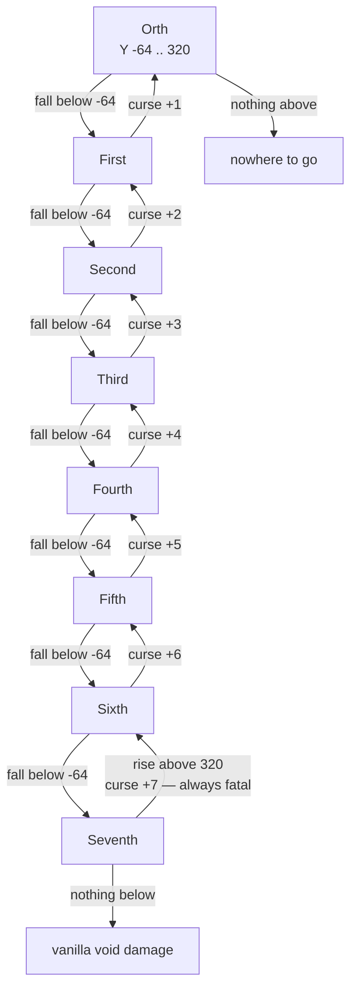
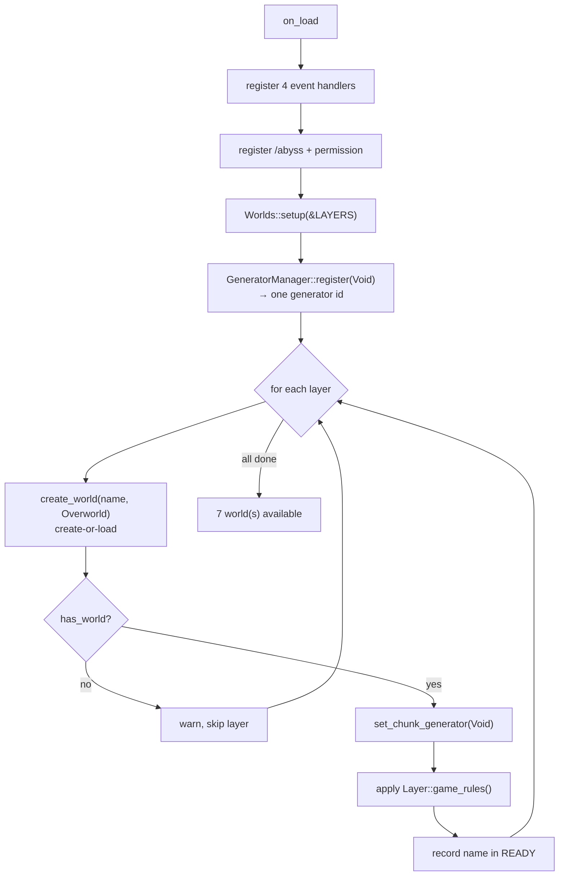
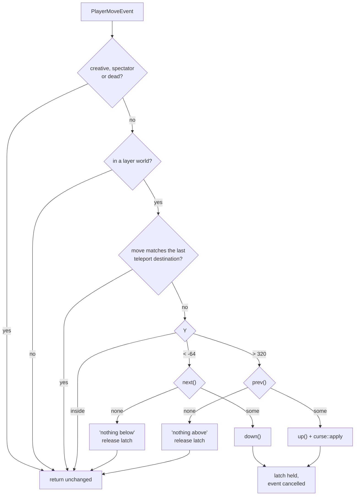
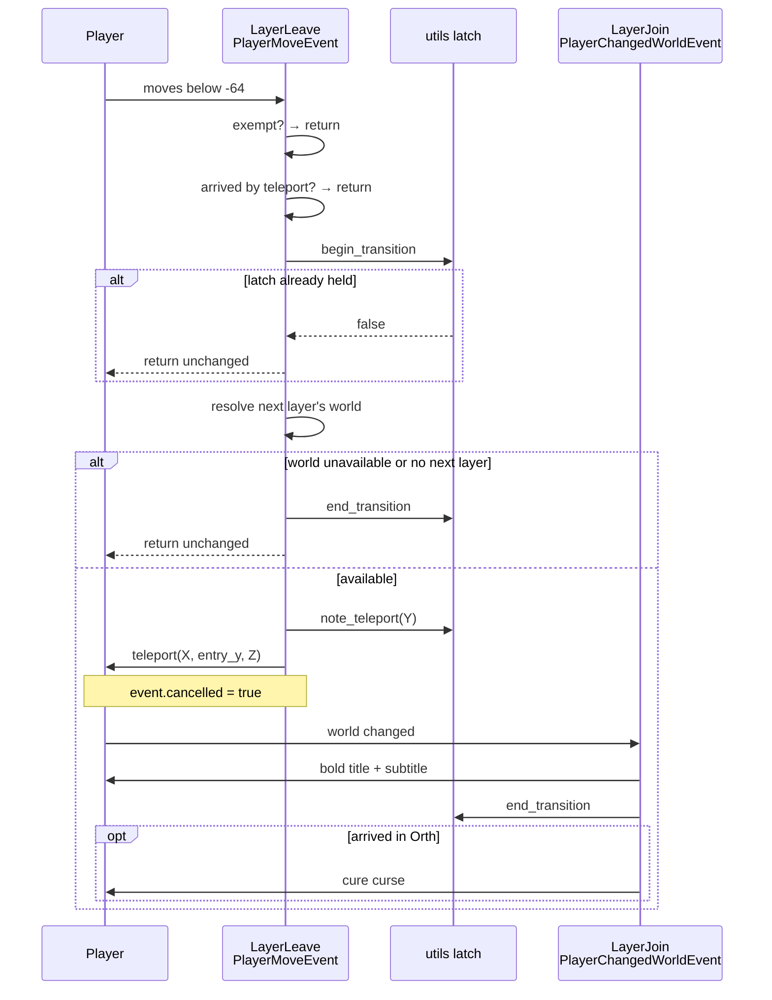
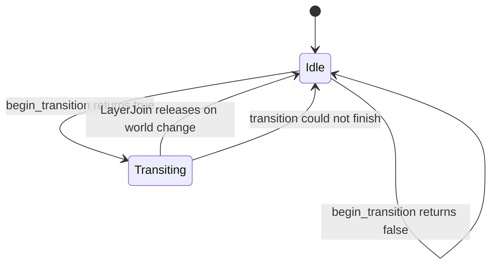
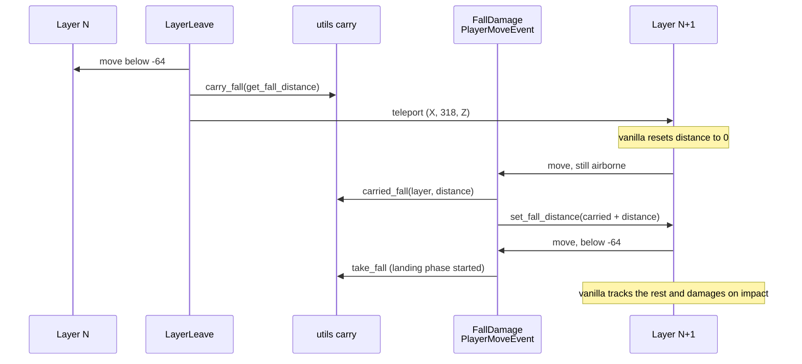
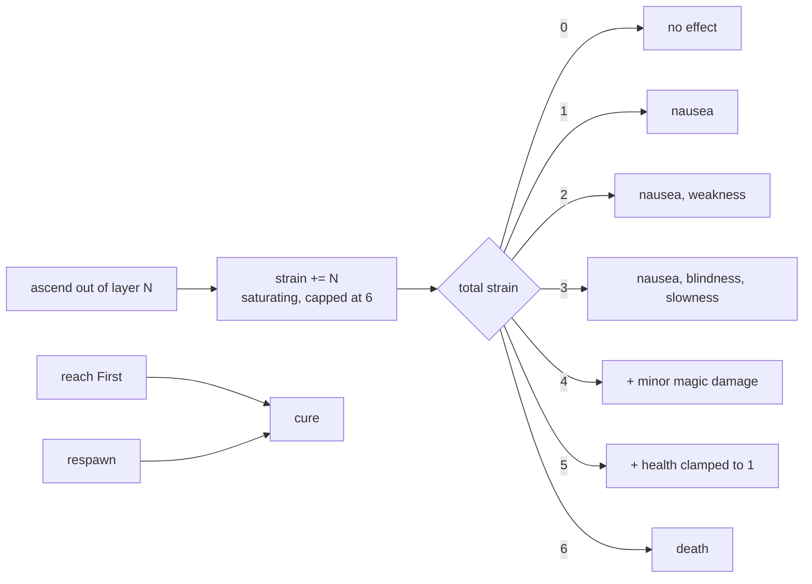

# Architecture

How `mine-in-abyss` maps a vertical Abyss onto Minecraft worlds, and how a player moves
from one layer to the next. For installation and player-facing behaviour see
[`GUIDE.md`](GUIDE.md).

## Table of Contents

- [The core idea](#the-core-idea)
- [Layers](#layers)
- [Startup](#startup)
- [Leaving a layer](#leaving-a-layer)
- [The transition handshake](#the-transition-handshake)
- [Why the latch exists](#why-the-latch-exists)
- [Fall damage across layers](#fall-damage-across-layers)
- [Monster difficulty](#monster-difficulty)
- [No bed spawns](#no-bed-spawns)
- [Respawning](#respawning)
- [The Curse of the Abyss](#the-curse-of-the-abyss)
- [Commands](#commands)
- [Known constraints](#known-constraints)
- [Entity transitions (not implemented)](#entity-transitions-not-implemented)

---

## The core idea

The Abyss is a vertical world, but a Minecraft world is finite and full-height. Rather
than stack layers inside one world, **each layer is its own world**, and descending means
crossing a world boundary.

The `+n` is [`Layer::curse`](src/layer.rs) — the layer's depth index — added to the
strain the player already carries. Strain saturates at **6**, so climbing out of `Seventh`
(7 points on its own) is always fatal, and every tier below it depends on how much strain
the player has already accumulated.

Every transition preserves the player's **X and Z**; only their Y and their world change.
Because each layer is a full-height world, the void and ceiling bands of neighbouring
layers never overlap.

## Layers

[`Layer`](src/layer.rs) is the single source of truth. There is no per-layer trait or
module — a layer _is_ an enum variant, and its identifier, world name, display name,
palette, game rules and curse severity are all derived from it.

| Variant   | `id()`    | World                   | `name()`                      |
| --------- | --------- | ----------------------- | ----------------------------- |
| `Orth`    | `orth`    | `mine_in_abyss_orth`    | The City on the Edge          |
| `First`   | `first`   | `mine_in_abyss_first`   | Depths of the Abyss           |
| `Second`  | `second`  | `mine_in_abyss_second`  | The Forest of Temptation      |
| `Third`   | `third`   | `mine_in_abyss_third`   | The Great Fault               |
| `Fourth`  | `fourth`  | `mine_in_abyss_fourth`  | The Goblets of Giants         |
| `Fifth`   | `fifth`   | `mine_in_abyss_fifth`   | The Sea of Corpses            |
| `Sixth`   | `sixth`   | `mine_in_abyss_sixth`   | The Capital of the Unreturned |
| `Seventh` | `seventh` | `mine_in_abyss_seventh` | The Final Maelstrom           |

`next()`, `prev()`, `index()` and `curse()` all derive from the variant **order**, so
adding or reordering a layer carries them along automatically. `id()` comes from
`IntoStaticStr`, so a variant name is never written twice.

Two constants are shared by every layer, because all eight are Overworld-dimension worlds
of the same height:

- `Layer::MIN_Y` = `-64` — the world floor, and where a player counts as having left
  downwards
- `Layer::MAX_Y` = `320` — just above the build limit, and where leaving upwards begins

## Startup

`MineInAbyss::on_load` registers handlers and commands, then creates the worlds.

Three ordering details matter:

- **The generator is attached before the world is used.** There is no window in which a
  chunk could be generated by the default generator, so a brand-new layer world starts
  empty rather than as generated terrain that would later compete with an authored map.
- **`create_world` is create-or-load.** A world that already exists on disk is reused
  untouched; only its game rules and generator are re-applied.
- **One generator id serves all eight worlds.** The handler is stored once and shared.

`World` is a non-cloneable WIT resource, so only the _names_ of ready worlds are cached in
a thread-local; the handle is re-resolved from the server on demand.

## Leaving a layer

`LayerLeave` runs on `PlayerMoveEvent`, which fires on every movement, and decides whether
the player has crossed a band.

`down` and `up` share a shape: resolve the destination world, keep X and Z, and teleport
to a fixed Y — `entry_y()` (318) when descending, `exit_y()` (-63) when ascending.

Only **creative, spectator and dead** players are exempt. The first two let builders and
onlookers pass through the void and ceiling freely; the latter stops a corpse being
teleported, or a corpse being cursed, by the move events that follow a death.

## The transition handshake

A transition is not one event. It is a handshake between two handlers and a latch.

Cancelling the move matters: the teleport has already placed the player, and the original
`to_position` describes a point back inside the band of the world they just left.

Recording the teleport matters too. `PlayerTeleportEvent` carries no world, so `LayerTeleport`
stores only the destination Y. `LayerLeave` consumes that record once and ignores a move
within `TELEPORT_TOLERANCE` (2 blocks) of it — so an operator teleporting overhead is not
read as a climb and cursed, while a genuine climb immediately afterwards still is.

## Why the latch exists

`PlayerMoveEvent` fires every tick the player moves. Without a latch, a player standing
inside the void band would be teleported — and cursed — over and over.

The latch is taken by `LayerLeave` and released by `LayerJoin` — **not** immediately after
the teleport — so the moves and the world change that follow cannot re-trigger the
transition.

It is deliberately **in-memory only**. A stale entry after a restart would lock a player
out of transitions permanently, so nothing about it is persisted.

## Fall damage across layers

Vanilla resets a player's fall distance every time they change world, and a layer world is
only 384 blocks tall. A drop that spans several layers would therefore be a series of
separate falls, each far too short to hurt — falling from `First` to `Sixth` would cost
nothing.

`Entity::get_fall_distance` and `set_fall_distance` are what make this fixable:

Two details carry the design:

- **The carry is added while falling, not on impact.** Adding it on impact would depend on
  vanilla's own accounting, which the handler has already replaced; adding it every move
  means the distance vanilla finally sees is the whole descent. The landing phase starts
  at [`Layer::MIN_Y`](src/layer.rs), where the carry is dropped and vanilla takes over.
- **The distance is measured before the teleport.** It is read from the layer being left,
  where it still describes the drop so far; the world change is what would erase it.

Damage is never applied directly — vanilla still decides the impact, so water, hay bales,
beds, slow falling and feather falling all behave as they do in vanilla.

**A fall that leaves a layer airborne is not joined up.** If the player never reaches ground
in an empty layer, the next swap records the segment of that world only, over the previous
carry. Joining them would need the damage to be applied where the player is not — see the
comment on [`resume_fall`](src/utils.rs). The baseline stays vanilla's per-world damage.

A teleport or a respawn clears the carry: the drop it described is over.

## Monsters do not scale, and do not follow

A mob is exactly what its entity type says, in every layer — there is no depth multiplier
and no per-layer allow-list. Descending is still an escape: entities cannot change layers
and nothing moves them between worlds, so the mobs in the layer a player leaves stay there.
The layer they land in holds only its own inhabitants.

## No bed spawns

The Abyss is escaped on its own terms, so a player cannot set a spawn point: a bed at the
bottom of `Seventh` would let them skip the climb — and the Curse — by dying there.
`BedSpawn` cancels `PlayerSpawnChangeEvent` and says why in a red action bar message.

The filter is `!forced && new_spawn.is_some()`:

- **`forced`** is set only by `/spawnpoint`, which passes `forced: true` because an
  operator asked for it. Beds and respawn anchors both pass `forced: false`. Cancelling
  unconditionally would take away the operator's escape hatch.
- **`new_spawn: None`** means a point is being _cleared_, not set, so clearing still works.

Cancelling is enough on its own: the host returns `false` from `set_respawn_point` and
never sends its usual "Spawn point set" message, so the only feedback is the one this
handler adds.

## Respawning

Dying returns the player to **`First`'s world spawn**, not wherever they died. Combined
with [no bed spawns](#no-bed-spawns) there is no way to bank a point further down, so death
is never a shortcut home.

`LayerRespawn` runs on `PlayerRespawnEvent`, which is **not cancellable** and fires after
the host has already resolved a destination. So the respawn happens first and the player is
moved again immediately: this is a teleport, not a redirection. Two consequences worth
knowing:

- The host only resolves `First`'s position when the player died in `First`. Everywhere
  else it falls back to the **`OVERWORLD` dimension's** spawn, which is not a layer world —
  so the handler has to supply the world itself, not just a position.
- Rewriting `PlayerSpawnLocationEvent` instead would move the position but **not** the
  world, which is why it is not used here.

The spawn is read from `World::get_spawn_location()`, so changing the world spawn in
`First` moves the respawn point with it. The handler also cures the curse and clears any
carried fall, so a death never leaves a debuff or a resumed descent behind.

## The Curse of the Abyss

Ascending adds strain; the strain is cumulative and stored as namespaced NBT on the player,
so it survives a relog. Only reaching the surface or dying clears it.

Ascending several layers in one go compounds: the severity comes from
`Layer::curse()`, which is the layer's index, so climbing out of `Seventh` is fatal on
its own.

`/abyss` teleports **without** adding strain — it is an ops shortcut, not a climb.

## Commands

`/abyss <layer> [player]` (alias `/mia`) is the only command.

| Event handler   | Event                     | Responsibility                                        |
| --------------- | ------------------------- | ----------------------------------------------------- |
| `LayerJoin`     | `PlayerChangedWorldEvent` | Entry title; release latch; cure in `Orth`            |
| `LayerLeave`    | `PlayerMoveEvent`         | Void/ceiling detection, teleport, curse               |
| `FallDamage`    | `PlayerMoveEvent`         | Adds the carried descent to the fall distance         |
| `BedSpawn`      | `PlayerSpawnChangeEvent`  | Refuses player-set spawn points, keeps `/spawnpoint`  |
| `LayerRespawn`  | `PlayerRespawnEvent`      | Returns the player to `Orth`'s spawn, cures the curse |
| `LayerTeleport` | `PlayerTeleportEvent`     | Record where a teleport put the player                |

A **player** running `/abyss` is always the one moved; `[player]` is only consulted from
console. This is not a stylistic choice — the host returns an omitted argument as
`Arg::Simple("")` rather than a missing variant, so a name lookup on the common path would
run with a blank name and fail.

Tab-completion for `<layer>` is implemented but disabled. Attaching it makes the Pumpkin
host panic on the first suggestion request: `WasmCommandSuggestionProvider` calls
`block_in_place` from the simulation thread, which has no Tokio reactor. The handler is
kept behind `cfg(any())` and re-enabling it is described in `src/commands/abyss.rs`.

## Known constraints

These are host or design limits the plugin works within, not bugs to fix casually.

- **Worlds are generated empty.** There is no ground in a fresh layer. Entering one means
  falling from Y=318 straight through, which `LayerLeave` reads as a descent and chains
  into the next layer down. A layer needs authored map data before it is playable.
- **Do not assume ground at a given X/Z.** Transitions preserve X and Z and pick a Y from
  `entry_y`/`exit_y`; whether that lands on anything solid depends entirely on the map.
- **A partial map yields a hybrid world.** Existing chunks are never regenerated, so
  chunks beyond an authored map's edge generate as air.
- **No spawn-point setter is exposed.** A void world's spawn sits at the origin, so
  arrivals must be driven by the transition code or by map data.
- **Difficulty is server-wide** and has no setter, so peaceful behaviour is expressed as
  per-world game rules (`Orth` and `First` disable `spawn-monsters`).
- **A fall is only carried one layer.** A descent resets the fall distance at every world
  boundary, and the carry described above is measured in the layer the player arrives in.
  Someone who falls from `First` without ever landing is hurt by the last segment, not the
  whole drop.
- **Only players change layers.** Players have `PlayerMoveEvent` and
  `PlayerChangedWorldEvent`; no other entity has a move or world-change event, so a falling
  item or mob stays in the layer it was in. See the section below before "fixing" this.

## Entity transitions (not implemented)

An item or mob thrown into the void does **not** descend; it falls to the world floor and
is then subject to vanilla void damage. This is a deliberate deferment, not an oversight.

What an implementation would need, and why it was declined for now:

- The plugin is never told that a non-player entity crossed a boundary. There is no
  entity move event and no entity world-change event in `pumpkin-plugin-api`, so the only
  route is polling `World::get_entities()` across all seven worlds on a repeating task.
- `get_entities()` clones every entity in the world into WASM resources on each pass, so
  the poll costs `entity count × poll rate` regardless of whether anything is falling.
  A per-move entity event would be expensive at the WASM boundary, which is plausibly why
  the API exposes `player-move` and `vehicle-move` but nothing general.
- `Entity::teleport` does take a world, and `EntitySpawnEvent` supplies an entity id, so
  the primitives exist. An `Entity` PDC marker would survive the world change and a
  restart, which makes it the right place for "this entity descends".
- The item entity's own `ItemStack` is **not** readable, so an item cannot be destroyed and
  re-created faithfully. It must be moved with `Entity::teleport`, which is also why its
  contents are preserved for free.

If `EntityMoveEvent` lands upstream, prefer it: it would let entity transitions mirror
[`layer_leave`](src/events/layer_leave.rs) — reactive, no poll, no marker, no scheduler
entry. Note that Paper's own `EntityMoveEvent` is not fired for every entity, which is why
`DeeperWorld`, the equivalent plugin for Paper, still keeps separate `PlayerMoveEvent` and
`VehicleMoveEvent` listeners alongside it.
