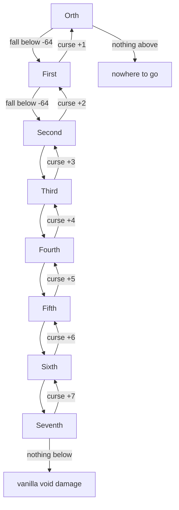
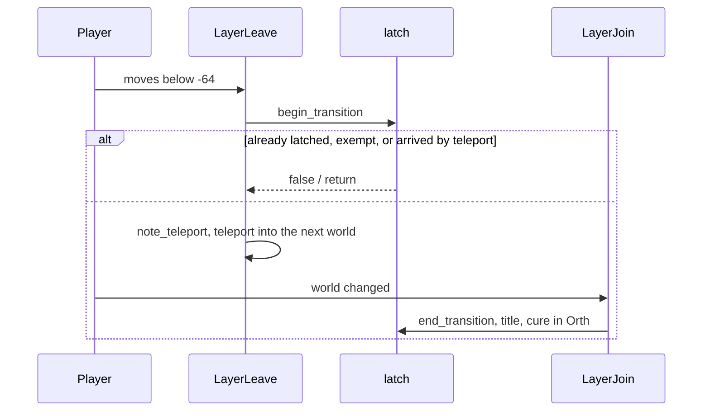

# Architecture

How the Abyss maps onto Minecraft worlds, and how a player crosses between layers. For
installation see [`GUIDE.md`](GUIDE.md).

## The core idea

A Minecraft world is finite and full-height, so rather than stacking layers inside one world,
**each layer is its own world**. Descending means crossing a world boundary: fall below
`Y = -64` and the player is teleported into the next layer's world at the top; rise above
`Y = 320` and the previous layer is restored. X and Z are always preserved.

Ascending adds the layer's depth index to a cumulative strain that saturates at 6, so leaving
`Seventh` is always fatal on its own.

## Startup and layers

`on_load` registers the event handlers and commands, then calls `Worlds::setup(&LAYERS)`. That
registers a single `Void` chunk generator, creates or loads each layer world, attaches the
generator *before* the world is used, and applies the layer's game rules. A world already on
disk is reused untouched.

Per-layer facts are data on [`Layer`](src/layer.rs); per-layer behaviour is a `match` in the
event handler that owns it.

## Transitions

`LayerLeave` runs on `PlayerMoveEvent` and compares the move against the world floor and
ceiling. A transition is a handshake, not one event:

Two details carry it:

- **The latch lives until the world change.** `PlayerMoveEvent` fires every tick, so without
  it a player inside the void band would be teleported — and cursed — repeatedly. Releasing
  straight after the teleport would let the following moves re-trigger. It is in-memory only,
  because a stale entry would lock a player out of transitions after a restart.
- **A teleport is not a climb.** `PlayerTeleportEvent` carries no world, so `LayerTeleport`
  records only the destination Y and `LayerLeave` consumes it once, ignoring a move within two
  blocks of it.

## Fall damage across layers

Vanilla resets the fall distance on a world change, and a layer is only 384 blocks tall, so a
descent would otherwise never hurt. `LayerLeave` reads the distance *before* the teleport and
`FallDamage` adds it on each move in the new layer until the player passes the floor, where
vanilla takes over. Damage is never applied directly, so water and feather falling still work.
Only one layer is carried: a player who never lands is hurt by the last segment only. A
teleport or respawn clears the carry.

## The Curse of the Abyss

Strain is namespaced NBT on the player, so it survives a relog and only reaching `Orth` or
dying clears it. The death tier is `6 or more` rather than exactly 6, so `MAX_STRAIN` must stay
at the deepest value `Layer::curse()` can return. Raising it means adding matching arms to
`inflict` in the same change. `/abyss` teleports without adding strain.

## Spawns and respawning

- **No bed spawns.** A bed at the bottom of `Seventh` would let a player skip the climb by
  dying there, so `BedSpawn` cancels `PlayerSpawnChangeEvent` unless the change is `forced`
  (which is how `/spawnpoint` works) or is clearing the point.
- **Death returns to `Orth`'s spawn.** `PlayerRespawnEvent` is not cancellable and fires after
  the host resolved a destination, so `LayerRespawn` moves the player again afterwards — and
  must supply the world, because outside `First` the host falls back to the Overworld
  dimension's spawn.

## Commands

`/abyss <layer> [player]` (alias `/mia`) is the only command; a player running it is always
the one moved. Tab-completion is implemented but disabled behind `cfg(any())`: attaching it
makes the host panic on the first suggestion request. Details are in `src/commands/abyss.rs`.

## Known constraints

- **Worlds are generated empty.** Entering one with no authored map means falling straight
  through, which `LayerLeave` reads as a descent into the next layer.
- **Do not assume ground at a given X/Z.** Whether an arrival lands on anything solid depends
  entirely on the map.
- **A partial map yields a hybrid world:** chunks beyond an authored map's edge generate as
  air, and existing chunks are never regenerated.
- **No spawn-point setter is exposed**, so arrivals are driven by the transition code or map.
- **Difficulty is server-wide**; peaceful behaviour is expressed as per-world game rules.
- **Only players change layers.** No other entity has a move or world-change event.
- **Entity transitions are not implemented**, deliberately. There is no entity move event, so
  the only route is polling `get_entities()` across every world, which clones each entity into
  WASM on every pass. If `EntityMoveEvent` lands upstream, prefer it.
