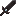

<!-- markdownlint-disable MD013 -->

# Hostile

The creatures that hunt you. Twenty-three in all, and the deepest layers hold the worst of them.

| Creature | Base | Hearts | Layers |
| :------- | :--- | -----: | :----- |
| **Chikyuoebi** | Spider | 42.5 | Fifth |
| **Himushi** | Magma Cube | 30 | Third |
| **Horncrier** | Parrot | 30 | Fourth, Fifth |
| **Inbyo** | Spider | 12.5 | Second |
| **Kuongatari** | Spider | 15 | Fourth, Fifth |
| **Man-Toyer** | Parrot | 7.5 | First |
| **Octoliar** | Squid | 40 | Fifth |
| **Orb Piercer** | Cave Spider | 90 | Fourth |
| **Ottobas** | Ravager | 45 | First |
| **Shiratsubi** | Vex | 22.5 | Fifth |
| **Silkfang** | Parrot | 11 | First, Second |
| **Spittleshrub** | Parrot | 10 | First, Second, Fourth |
| **Stingerhead** | Phantom | 130 | Fifth |
| **Swarmhoarder** | Bee | 35 | Fifth |
| **Swarmshocker** | Bee | 10 | Fourth, Fifth |
| **Tachikatana** | Spider | 110 | Fourth, Fifth |
| **Uibuta** | Hoglin | 35 | Fourth, Fifth |
| **Vinebinder** | Creeper | 10 | First, Second |
| **Vineblaster** | Creeper | 8 | First, Second |
| **Vinepoofer** | Creeper | 10 | First, Second |
| **Virinsipede** | Silverfish | 75 | Fifth |
| **Woodcrier** | Parrot | 30 | First, Second |
| **Yomotsubi** | Vex | 20 | Third |

## The Heavy Hitters

| Creature | Hearts | Layer |
| :------- | -----: | :---- |
|  Stingerhead | 130 | Fifth |
|  Tachikatana | 110 | Fourth, Fifth |
|  Orb Piercer | 90 | Fourth |
|  Virinsipede | 75 | Fifth |

The **Stingerhead** is the strongest creature in the Abyss. The **Tachikatana** and **Orb
Piercer** are close behind, and both live in the Goblets of Giants.

## Notes

- **The Vine family is built on Creepers.** Vinebinder, Vineblaster and Vinepoofer all share the
  First and Second — and all three inherit Creeper explosion behaviour.
- **Ottobas is a Ravager** and lives in the First, making it the most dangerous thing above the
  Second at 45 hearts.
- **Man-Toyer is the weakest hostile creature** at 7.5 hearts, in the First.
- **Himushi is a Magma Cube**, so it brings vanilla Magma Cube behaviour to the Great Fault.
- **The Bees are hostile here.** Swarmhoarder and Swarmshocker are built on Bees but are
  creatures of the Abyss, not of a hive.
