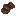

<!-- markdownlint-disable MD013 -->

# Creatures

Every creature in the Abyss is a **vanilla entity wearing an identity**. The server replaces
natural mob spawning in each layer with kinds authored for that layer, so what you meet is
always something from the Abyss rather than a stock zombie.

## Passive

Harmless creatures. They wander, they breed nothing, and they never fight back.

Abyssal Snail20
A slow shell of the deep water.

Ashimite17.5
A sure-footed climber of the Sea of Corpses.

Billabonk10
A pond-dweller of the Forest of Temptation.

Fuwagi5
A skittish white rabbit of the first two layers.

Ikonia80
The toughest gentle creature in the Abyss.

Kakatsumuri2.5
The frailest creature in the Abyss.

Neritantan3.5
A small burrower of the forest and fault.

Okibo20
The only creature that lives in Orth.

Sakuranbo5
A drifting blossom of the Great Fault.

Shroombear12.5
A quiet grazer of the Goblets of Giants.

Tesuchi10
A shelled wanderer of the Depths.

## Docile

Calm creatures that leave you alone — until you give them a reason not to.

Beniguma8
A wolf-like prowler of the first two layers.

Chimokami15
A cunning beast of the Depths.

Daikonchu40
A giant that outclasses every hostile of its layer.

Hisoishi12.5
A small skittering creature of the middle layers.

Rinsipede15
A many-legged crawler of the Great Fault.

Rockwalker12.5
A stone-dwelling creature of the middle layers.

Spikewalker20
A bristling creature of the Sea of Corpses.

Titanjaw30
A shelled giant of the deepest inhabited layer.

## Aerial

Flyers. Some circle overhead, some dive, and a few are the largest creatures in the Abyss.

Buroguro16
A humming drifter of the Great Fault.

Corpse-Weeper17.5
A wailing shape that haunts the Depths.

Cyatoria12.5
A lithe flyer of the first two layers.

Dosetori15
A bright-winged flyer of the upper layers.

Giant Hammerbeak20
The larger of the two Hammerbeaks.

Hashofu10
A pale flier of the deeper layers.

Kagi-Tachikiri25
A hooked horror of the Sea of Corpses.

Madokajack20
A hovering stalker of the Great Fault.

Onitsuchi25
A broad-winged flyer of the lower layers.

Rohana5
The frailest flyer in the Abyss.

Small Hammerbeak9
The smaller of the two Hammerbeaks.

Splitjaw45
The apex flyer of the upper layers.

Spore Manta15
A drifting spore-carrier of the deep.

Squidfly8
A fluttering thing of the Great Fault.

Stinger8
A stinging flyer that ranges across three layers.

## Aquatic

Water creatures. All of them are built on a vanilla aquatic base, so they move and behave like
their model.

Demonfish15
A venomous fish of the Sea of Corpses.

Edusan40
A watchful guardian of the deep water.

Hagamizukin25
A schooling fish of the lower layers.

Hisomukuro40
A lurking shape in the deep water.

Ikenosuke6
The most widespread water creature.

Kazura2.5
A faint glow in the Goblets of Giants.

Makihige30
A many-tentacled creature of the lower layers.

Spiralsquid4
The only water creature above the Second.

## Hostile

The creatures that hunt you. The deepest layers hold the worst of them.

Chikyuoebi42.5
A plated hunter of the Sea of Corpses.

Himushi30
A burning mass of the Great Fault.

Horncrier30
A shrieking hunter of the lower layers.

Inbyo12.5
A lurking spider of the Forest of Temptation.

Kuongatari15
A skittering spider of the Goblets of Giants.

Man-toyer7.5
The weakest hostile creature.

Octoliar40
A tentacled liar of the deep water.

Orb Piercer90
The terror of the Goblets of Giants.

Ottobas45
The most dangerous creature above the Second.

Shiratsubi22.5
A pale stinger of the Sea of Corpses.

Silkfang11
A quiet hunter of the first two layers.

Spittleshrub10
A spitting ambusher that ranges across three layers.

Stingerhead130
The strongest creature in the Abyss.

Swarmhoarder35
A stinging swarm of the Sea of Corpses.

Swarmshocker10
A stinging swarm of the lower layers.

Tachikatana110
A blade-limbed hunter second only to the Stingerhead.

Uibuta35
A heavy brute of the lower layers.

Vinebinder10
A creeping vine-horror of the upper layers.

Vineblaster8
A bursting vine-horror of the upper layers.

Vinepoofer10
A puffing vine-horror of the upper layers.

Virinsipede75
A venomous crawler of the Sea of Corpses.

Woodcrier15
A wailing hunter of the first two layers.

Yomotsubi20
A hovering menace of the Great Fault.

## The Heavy Hitters

| Creature        | Hearts | Layer         |
| :-------------- | -----: | :------------ |
| **Stingerhead** |    130 | Fifth         |
| **Tachikatana** |    110 | Fourth, Fifth |
| **Orb Piercer** |     90 | Fourth        |
| **Virinsipede** |     75 | Fifth         |

The **Stingerhead** is the strongest creature in the Abyss. The **Tachikatana** and **Orb
Piercer** are close behind, and both live in the Goblets of Giants.

## How They Work

- **Creatures never scale with depth.** A creature is exactly what its kind says, at every layer
  it lives in.
- **Creatures never change layers.** Nothing follows you down, and nothing climbs up.
- **Spawner, breeding, eggs and commands are left alone.** The layer spawning rules only replace
  _natural_ spawns, so a creature you deliberately place stays.
- **Each kind lists the layers it lives in.** That list is the only thing deciding what lives
  where.

## Creature Count

There are **65 kinds** in all:

|                                             Category                                              | Kinds |
| :-----------------------------------------------------------------------------------------------: | :---: |
|  Hostile |  24   |
|        Aerial       |  15   |
|       Passive       |  12   |
|       Docile       |   8   |
|  Aquatic  |   8   |

## Layer Populations

| Layer                                                                                                              | Kinds |
| :----------------------------------------------------------------------------------------------------------------- | :---: |
|  The City on the Edge                     |   1   |
|  Depths of the Abyss                   |  20   |
|  The Forest of Temptation           |  21   |
|  The Great Fault                       |  14   |
|  The Goblets of Giants              |  18   |
|  The Sea of Corpses                    |  26   |
|  The Capital of the Unreturned |   0   |
|  The Final Maelstrom           |   0   |

The Sixth and Seventh have no creatures authored for them yet, so once you reach them the Abyss
falls silent.
