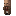
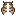
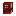
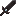
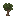
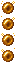
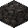
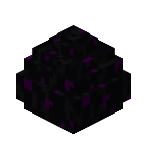

# Creatures

Every creature in the Abyss is a **vanilla entity wearing an identity**. The server replaces
natural mob spawning in each layer with kinds authored for that layer, so what you meet is
always something from the Abyss rather than a stock zombie.

<a class="card" href="passive.html">

Passive

Harmless creatures that never fight back
</a>

<a class="card" href="docile.html">

Docile

Calm until provoked, then dangerous
</a>

<a class="card" href="aerial.html">

Aerial

Flyers, soarers, and things that dive
</a>

<a class="card" href="aquatic.html">

Aquatic

Creatures of the water
</a>

<a class="card" href="hostile.html">

Hostile

The things that hunt you
</a>

## How They Work

- **Creatures never scale with depth.** A creature is exactly what its kind says, at every layer
  it lives in.
- **Creatures never change layers.** Nothing follows you down, and nothing climbs up.
- **Spawner, breeding, eggs and commands are left alone.** The layer spawning rules only replace
  *natural* spawns, so a creature you deliberately place stays.
- **Each kind lists the layers it lives in.** That list is the only thing deciding what lives
  where.

## Creature Count

There are **65 kinds** in all:

| Category | Kinds |
| :------: | :---: |
|  Hostile | 24 |
|  Aerial | 15 |
|  Passive | 12 |
|  Docile | 8 |
|  Aquatic | 8 |

## Layer Populations

| Layer | Kinds |
| :-------- | :---: |
|  The City on the Edge | 1 |
|  Depths of the Abyss | 20 |
|  The Forest of Temptation | 21 |
|  The Great Fault | 14 |
|  The Goblets of Giants | 18 |
|  The Sea of Corpses | 26 |
|  The Capital of the Unreturned | 0 |
|  The Final Maelstrom | 0 |

The Sixth and Seventh have no creatures authored for them yet, so once you reach them the Abyss
falls silent.
