<!-- markdownlint-disable MD013 -->

# Creatures

Every creature in the Abyss, sorted by layer, name or category, with its base type, hearts and where it lives.

<label class="sort-label" for="creature-sort-select">Sort by</label>
<select id="creature-sort-select" class="sort-select">
<option value="name-asc" selected>A–Z</option>
<option value="name-desc">Z–A</option>
<option value="layer-asc">Layer ascending</option>
<option value="layer-desc">Layer descending</option>
<option value="category-asc">Category ascending</option>
<option value="category-desc">Category descending</option>
</select>

Abyssal Snail20
A slow shell of the deep water.

2 drops

<table class="creature-drops">
<thead><tr><th>Drop</th><th>Chance</th></tr></thead>
<tbody><tr><td></td><td>70%</td></tr>
<tr><td>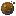1-2</td><td>70%</td></tr>
</tbody>
</table>

Ashimite17.5
A sure-footed climber of the Sea of Corpses.

3 drops

<table class="creature-drops">
<thead><tr><th>Drop</th><th>Chance</th></tr></thead>
<tbody><tr><td>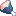1-2</td><td>60%</td></tr>
<tr><td>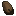1-2</td><td>30%</td></tr>
<tr><td></td><td>30%</td></tr>
</tbody>
</table>

Billabonk10
A pond-dweller of the Forest of Temptation.

1 drop

<table class="creature-drops">
<thead><tr><th>Drop</th><th>Chance</th></tr></thead>
<tbody><tr><td>1-2</td><td>60%</td></tr>
</tbody>
</table>

Fuwagi5
A skittish white rabbit of the first two layers.

3 drops

<table class="creature-drops">
<thead><tr><th>Drop</th><th>Chance</th></tr></thead>
<tbody><tr><td>1-2</td><td>60%</td></tr>
<tr><td>1-2</td><td>30%</td></tr>
<tr><td></td><td>70%</td></tr>
</tbody>
</table>

Ikonia80
The toughest gentle creature in the Abyss.

1 drop

<table class="creature-drops">
<thead><tr><th>Drop</th><th>Chance</th></tr></thead>
<tbody><tr><td>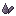1-1</td><td>50%</td></tr>
</tbody>
</table>

Kakatsumuri2.5
The frailest creature in the Abyss.

2 drops

<table class="creature-drops">
<thead><tr><th>Drop</th><th>Chance</th></tr></thead>
<tbody><tr><td></td><td>80%</td></tr>
<tr><td></td><td>90%</td></tr>
</tbody>
</table>

Neritantan3.5
A small burrower of the forest and fault.

5 drops

<table class="creature-drops">
<thead><tr><th>Drop</th><th>Chance</th></tr></thead>
<tbody><tr><td>1-2</td><td>60%</td></tr>
<tr><td>1-2</td><td>30%</td></tr>
<tr><td>1-2</td><td>30%</td></tr>
<tr><td>1-2</td><td>30%</td></tr>
<tr><td>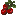1-2</td><td>30%</td></tr>
</tbody>
</table>

Okibo20
The only creature that lives in Orth.

2 drops

<table class="creature-drops">
<thead><tr><th>Drop</th><th>Chance</th></tr></thead>
<tbody><tr><td>1-2</td><td>60%</td></tr>
<tr><td>1-2</td><td>70%</td></tr>
</tbody>
</table>

Sakuranbo5
A drifting blossom of the Great Fault.

1 drop

<table class="creature-drops">
<thead><tr><th>Drop</th><th>Chance</th></tr></thead>
<tbody><tr><td>1-3</td><td>90%</td></tr>
</tbody>
</table>

Shroombear12.5
A quiet grazer of the Goblets of Giants.

2 drops

<table class="creature-drops">
<thead><tr><th>Drop</th><th>Chance</th></tr></thead>
<tbody><tr><td>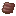1-2</td><td>60%</td></tr>
<tr><td>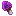1-2</td><td>60%</td></tr>
</tbody>
</table>

Tesuchi10
A shelled wanderer of the Depths.

2 drops

<table class="creature-drops">
<thead><tr><th>Drop</th><th>Chance</th></tr></thead>
<tbody><tr><td></td><td>100%</td></tr>
<tr><td>1-3</td><td>80%</td></tr>
</tbody>
</table>

Beniguma8
A wolf-like prowler of the first two layers.

2 drops

<table class="creature-drops">
<thead><tr><th>Drop</th><th>Chance</th></tr></thead>
<tbody><tr><td>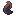1-2</td><td>60%</td></tr>
<tr><td>1-3</td><td>60%</td></tr>
</tbody>
</table>

Chimokami15
A cunning beast of the Depths.

2 drops

<table class="creature-drops">
<thead><tr><th>Drop</th><th>Chance</th></tr></thead>
<tbody><tr><td>1-3</td><td>80%</td></tr>
<tr><td>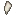1-2</td><td>70%</td></tr>
</tbody>
</table>

Daikonchu40
A giant that outclasses every hostile of its layer.

2 drops

<table class="creature-drops">
<thead><tr><th>Drop</th><th>Chance</th></tr></thead>
<tbody><tr><td></td><td>40%</td></tr>
<tr><td>1-2</td><td>30%</td></tr>
</tbody>
</table>

Hisoishi12.5
A small skittering creature of the middle layers.

2 drops

<table class="creature-drops">
<thead><tr><th>Drop</th><th>Chance</th></tr></thead>
<tbody><tr><td>1-3</td><td>80%</td></tr>
<tr><td></td><td>20%</td></tr>
</tbody>
</table>

Rinsipede15
A many-legged crawler of the Great Fault.

1 drop

<table class="creature-drops">
<thead><tr><th>Drop</th><th>Chance</th></tr></thead>
<tbody><tr><td>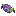1-2</td><td>80%</td></tr>
</tbody>
</table>

Rockwalker12.5
A stone-dwelling creature of the middle layers.

1 drop

<table class="creature-drops">
<thead><tr><th>Drop</th><th>Chance</th></tr></thead>
<tbody><tr><td>1-4</td><td>80%</td></tr>
</tbody>
</table>

Spikewalker20
A bristling creature of the Sea of Corpses.

2 drops

<table class="creature-drops">
<thead><tr><th>Drop</th><th>Chance</th></tr></thead>
<tbody><tr><td>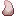1-3</td><td>80%</td></tr>
<tr><td>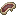1-2</td><td>60%</td></tr>
</tbody>
</table>

Titanjaw30
A shelled giant of the deepest inhabited layer.

2 drops

<table class="creature-drops">
<thead><tr><th>Drop</th><th>Chance</th></tr></thead>
<tbody><tr><td></td><td>20%</td></tr>
<tr><td>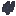1-2</td><td>60%</td></tr>
</tbody>
</table>

Buroguro16
A humming drifter of the Great Fault.

2 drops

<table class="creature-drops">
<thead><tr><th>Drop</th><th>Chance</th></tr></thead>
<tbody><tr><td></td><td>30%</td></tr>
<tr><td>1-2</td><td>60%</td></tr>
</tbody>
</table>

Corpse-Weeper17.5
A wailing shape that haunts the Depths.

3 drops

<table class="creature-drops">
<thead><tr><th>Drop</th><th>Chance</th></tr></thead>
<tbody><tr><td>1-2</td><td>100%</td></tr>
<tr><td>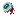2</td><td>30%</td></tr>
<tr><td>1-3</td><td>90%</td></tr>
</tbody>
</table>

Cyatoria12.5
A lithe flyer of the first two layers.

2 drops

<table class="creature-drops">
<thead><tr><th>Drop</th><th>Chance</th></tr></thead>
<tbody><tr><td>1-2</td><td>100%</td></tr>
<tr><td>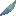1-4</td><td>70%</td></tr>
</tbody>
</table>

Dosetori15
A bright-winged flyer of the upper layers.

3 drops

<table class="creature-drops">
<thead><tr><th>Drop</th><th>Chance</th></tr></thead>
<tbody><tr><td>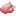1-2</td><td>100%</td></tr>
<tr><td>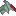1-3</td><td>70%</td></tr>
<tr><td>1-3</td><td>80%</td></tr>
</tbody>
</table>

Giant Hammerbeak20
The larger of the two Hammerbeaks.

4 drops

<table class="creature-drops">
<thead><tr><th>Drop</th><th>Chance</th></tr></thead>
<tbody><tr><td>1-3</td><td>100%</td></tr>
<tr><td>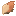</td><td>60%</td></tr>
<tr><td>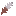1-3</td><td>70%</td></tr>
<tr><td>1-2</td><td>50%</td></tr>
</tbody>
</table>

Hashofu10
A pale flier of the deeper layers.

3 drops

<table class="creature-drops">
<thead><tr><th>Drop</th><th>Chance</th></tr></thead>
<tbody><tr><td></td><td>80%</td></tr>
<tr><td>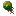2</td><td>65%</td></tr>
<tr><td>1-3</td><td>100%</td></tr>
</tbody>
</table>

Kagi-Tachikiri25
A hooked horror of the Sea of Corpses.

1 drop

<table class="creature-drops">
<thead><tr><th>Drop</th><th>Chance</th></tr></thead>
<tbody><tr><td>1-2</td><td>70%</td></tr>
</tbody>
</table>

Madokajack20
A hovering stalker of the Great Fault.

4 drops

<table class="creature-drops">
<thead><tr><th>Drop</th><th>Chance</th></tr></thead>
<tbody><tr><td>1-4</td><td>70%</td></tr>
<tr><td></td><td>30%</td></tr>
<tr><td>2</td><td>30%</td></tr>
<tr><td></td><td>30%</td></tr>
</tbody>
</table>

Onitsuchi25
A broad-winged flyer of the lower layers.

4 drops

<table class="creature-drops">
<thead><tr><th>Drop</th><th>Chance</th></tr></thead>
<tbody><tr><td>1-3</td><td>100%</td></tr>
<tr><td>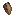</td><td>60%</td></tr>
<tr><td>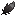1-3</td><td>100%</td></tr>
<tr><td>1-2</td><td>50%</td></tr>
</tbody>
</table>

Rohana5
The frailest flyer in the Abyss.

2 drops

<table class="creature-drops">
<thead><tr><th>Drop</th><th>Chance</th></tr></thead>
<tbody><tr><td>2</td><td>80%</td></tr>
<tr><td>2</td><td>40%</td></tr>
</tbody>
</table>

Small Hammerbeak9
The smaller of the two Hammerbeaks.

3 drops

<table class="creature-drops">
<thead><tr><th>Drop</th><th>Chance</th></tr></thead>
<tbody><tr><td>1-2</td><td>100%</td></tr>
<tr><td></td><td>60%</td></tr>
<tr><td>1-2</td><td>50%</td></tr>
</tbody>
</table>

Splitjaw45
The apex flyer of the upper layers.

5 drops

<table class="creature-drops">
<thead><tr><th>Drop</th><th>Chance</th></tr></thead>
<tbody><tr><td>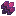1-3</td><td>70%</td></tr>
<tr><td>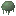2</td><td>70%</td></tr>
<tr><td></td><td>10%</td></tr>
<tr><td>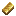</td><td>15%</td></tr>
<tr><td></td><td>10%</td></tr>
</tbody>
</table>

Spore Manta15
A drifting spore-carrier of the deep.

2 drops

<table class="creature-drops">
<thead><tr><th>Drop</th><th>Chance</th></tr></thead>
<tbody><tr><td>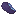1-2</td><td>50%</td></tr>
<tr><td>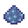1-2</td><td>70%</td></tr>
</tbody>
</table>

Squidfly8
A fluttering thing of the Great Fault.

1 drop

<table class="creature-drops">
<thead><tr><th>Drop</th><th>Chance</th></tr></thead>
<tbody><tr><td></td><td>80%</td></tr>
</tbody>
</table>

Stinger8
A stinging flyer that ranges across three layers.

2 drops

<table class="creature-drops">
<thead><tr><th>Drop</th><th>Chance</th></tr></thead>
<tbody><tr><td>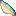</td><td>50%</td></tr>
<tr><td></td><td>20%</td></tr>
</tbody>
</table>

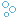Demonfish15
A venomous fish of the Sea of Corpses.

1 drop

<table class="creature-drops">
<thead><tr><th>Drop</th><th>Chance</th></tr></thead>
<tbody><tr><td>1-2</td><td>60%</td></tr>
</tbody>
</table>

Edusan40
A watchful guardian of the deep water.

2 drops

<table class="creature-drops">
<thead><tr><th>Drop</th><th>Chance</th></tr></thead>
<tbody><tr><td>4-8</td><td>100%</td></tr>
<tr><td></td><td>20%</td></tr>
</tbody>
</table>

Hagamizukin25
A schooling fish of the lower layers.

2 drops

<table class="creature-drops">
<thead><tr><th>Drop</th><th>Chance</th></tr></thead>
<tbody><tr><td>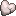1-2</td><td>60%</td></tr>
<tr><td>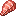1-2</td><td>60%</td></tr>
</tbody>
</table>

Hisomukuro40
A lurking shape in the deep water.

2 drops

<table class="creature-drops">
<thead><tr><th>Drop</th><th>Chance</th></tr></thead>
<tbody><tr><td>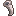2-6</td><td>70%</td></tr>
<tr><td>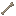0-5</td><td>100%</td></tr>
</tbody>
</table>

Ikenosuke6
The most widespread water creature.

1 drop

<table class="creature-drops">
<thead><tr><th>Drop</th><th>Chance</th></tr></thead>
<tbody><tr><td>1-2</td><td>60%</td></tr>
</tbody>
</table>

Kazura2.5
A faint glow in the Goblets of Giants.

1 drop

<table class="creature-drops">
<thead><tr><th>Drop</th><th>Chance</th></tr></thead>
<tbody><tr><td>1-2</td><td>80%</td></tr>
</tbody>
</table>

Makihige30
A many-tentacled creature of the lower layers.

3 drops

<table class="creature-drops">
<thead><tr><th>Drop</th><th>Chance</th></tr></thead>
<tbody><tr><td>1-2</td><td>60%</td></tr>
<tr><td>1-2</td><td>30%</td></tr>
<tr><td>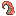1-2</td><td>40%</td></tr>
</tbody>
</table>

Spiralsquid4
The only water creature above the Second.

1 drop

<table class="creature-drops">
<thead><tr><th>Drop</th><th>Chance</th></tr></thead>
<tbody><tr><td>1-2</td><td>60%</td></tr>
</tbody>
</table>

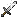Chikyuoebi42.5
A plated hunter of the Sea of Corpses.

3 drops

<table class="creature-drops">
<thead><tr><th>Drop</th><th>Chance</th></tr></thead>
<tbody><tr><td>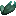1-2</td><td>60%</td></tr>
<tr><td>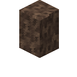2-4</td><td>60%</td></tr>
<tr><td></td><td>50%</td></tr>
</tbody>
</table>

Himushi30
A burning mass of the Great Fault.

3 drops

<table class="creature-drops">
<thead><tr><th>Drop</th><th>Chance</th></tr></thead>
<tbody><tr><td>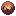</td><td>100%</td></tr>
<tr><td>1-2</td><td>60%</td></tr>
<tr><td>1-2</td><td>60%</td></tr>
</tbody>
</table>

Horncrier30
A shrieking hunter of the lower layers.

2 drops

<table class="creature-drops">
<thead><tr><th>Drop</th><th>Chance</th></tr></thead>
<tbody><tr><td>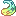</td><td>0.1%</td></tr>
<tr><td>1-3</td><td>60%</td></tr>
</tbody>
</table>

Inbyo12.5
A lurking spider of the Forest of Temptation.

2 drops

<table class="creature-drops">
<thead><tr><th>Drop</th><th>Chance</th></tr></thead>
<tbody><tr><td>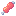1-2</td><td>60%</td></tr>
<tr><td>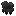1-3</td><td>60%</td></tr>
</tbody>
</table>

Kuongatari15
A skittering spider of the Goblets of Giants.

3 drops

<table class="creature-drops">
<thead><tr><th>Drop</th><th>Chance</th></tr></thead>
<tbody><tr><td></td><td>30%</td></tr>
<tr><td></td><td>30%</td></tr>
<tr><td>1-2</td><td>35%</td></tr>
</tbody>
</table>

Man-toyer7.5
The weakest hostile creature.

2 drops

<table class="creature-drops">
<thead><tr><th>Drop</th><th>Chance</th></tr></thead>
<tbody><tr><td>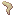1-2</td><td>60%</td></tr>
<tr><td>1-2</td><td>60%</td></tr>
</tbody>
</table>

Octoliar40
A tentacled liar of the deep water.

2 drops

<table class="creature-drops">
<thead><tr><th>Drop</th><th>Chance</th></tr></thead>
<tbody><tr><td>1-2</td><td>60%</td></tr>
<tr><td>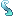1-2</td><td>60%</td></tr>
</tbody>
</table>

Orb Piercer90
The terror of the Goblets of Giants.

2 drops

<table class="creature-drops">
<thead><tr><th>Drop</th><th>Chance</th></tr></thead>
<tbody><tr><td>1-1</td><td>100%</td></tr>
<tr><td>2-6</td><td>100%</td></tr>
</tbody>
</table>

Ottobas45
The most dangerous creature above the Second.

1 drop

<table class="creature-drops">
<thead><tr><th>Drop</th><th>Chance</th></tr></thead>
<tbody><tr><td>4-15</td><td>100%</td></tr>
</tbody>
</table>

Shiratsubi22.5
A pale stinger of the Sea of Corpses.

2 drops

<table class="creature-drops">
<thead><tr><th>Drop</th><th>Chance</th></tr></thead>
<tbody><tr><td>1-2</td><td>60%</td></tr>
<tr><td>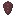1-2</td><td>70%</td></tr>
</tbody>
</table>

Silkfang11
A quiet hunter of the first two layers.

3 drops

<table class="creature-drops">
<thead><tr><th>Drop</th><th>Chance</th></tr></thead>
<tbody><tr><td>1-2</td><td>60%</td></tr>
<tr><td>1-2</td><td>60%</td></tr>
<tr><td></td><td>20%</td></tr>
</tbody>
</table>

Spittleshrub10
A spitting ambusher that ranges across three layers.

2 drops

<table class="creature-drops">
<thead><tr><th>Drop</th><th>Chance</th></tr></thead>
<tbody><tr><td>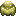1-3</td><td>60%</td></tr>
<tr><td>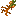</td><td>20%</td></tr>
</tbody>
</table>

Stingerhead130
The strongest creature in the Abyss.

3 drops

<table class="creature-drops">
<thead><tr><th>Drop</th><th>Chance</th></tr></thead>
<tbody><tr><td>1-2</td><td>100%</td></tr>
<tr><td>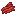1-2</td><td>100%</td></tr>
<tr><td>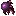1-2</td><td>40%</td></tr>
</tbody>
</table>

Swarmhoarder35
A stinging swarm of the Sea of Corpses.

3 drops

<table class="creature-drops">
<thead><tr><th>Drop</th><th>Chance</th></tr></thead>
<tbody><tr><td>1-2</td><td>60%</td></tr>
<tr><td>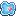1-2</td><td>60%</td></tr>
<tr><td></td><td>100%</td></tr>
</tbody>
</table>

Swarmshocker10
A stinging swarm of the lower layers.

1 drop

<table class="creature-drops">
<thead><tr><th>Drop</th><th>Chance</th></tr></thead>
<tbody><tr><td>1-2</td><td>30%</td></tr>
</tbody>
</table>

Tachikatana110
A blade-limbed hunter second only to the Stingerhead.

3 drops

<table class="creature-drops">
<thead><tr><th>Drop</th><th>Chance</th></tr></thead>
<tbody><tr><td>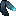1-2</td><td>80%</td></tr>
<tr><td>1-2</td><td>80%</td></tr>
<tr><td>2-8</td><td>80%</td></tr>
</tbody>
</table>

Uibuta35
A heavy brute of the lower layers.

2 drops

<table class="creature-drops">
<thead><tr><th>Drop</th><th>Chance</th></tr></thead>
<tbody><tr><td>2-5</td><td>100%</td></tr>
<tr><td>1-3</td><td>75%</td></tr>
</tbody>
</table>

Vinebinder10
A creeping vine-horror of the upper layers.

1 drop

<table class="creature-drops">
<thead><tr><th>Drop</th><th>Chance</th></tr></thead>
<tbody><tr><td>1-2</td><td>60%</td></tr>
</tbody>
</table>

Vineblaster8
A bursting vine-horror of the upper layers.

1 drop

<table class="creature-drops">
<thead><tr><th>Drop</th><th>Chance</th></tr></thead>
<tbody><tr><td>1-2</td><td>60%</td></tr>
</tbody>
</table>

Vinepoofer10
A puffing vine-horror of the upper layers.

1 drop

<table class="creature-drops">
<thead><tr><th>Drop</th><th>Chance</th></tr></thead>
<tbody><tr><td>1-2</td><td>60%</td></tr>
</tbody>
</table>

Virinsipede75
A venomous crawler of the Sea of Corpses.

2 drops

<table class="creature-drops">
<thead><tr><th>Drop</th><th>Chance</th></tr></thead>
<tbody><tr><td>4-10</td><td>80%</td></tr>
<tr><td>1-2</td><td>30%</td></tr>
</tbody>
</table>

Woodcrier15
A wailing hunter of the first two layers.

2 drops

<table class="creature-drops">
<thead><tr><th>Drop</th><th>Chance</th></tr></thead>
<tbody><tr><td>1-2</td><td>60%</td></tr>
<tr><td>1-3</td><td>60%</td></tr>
</tbody>
</table>

Yomotsubi20
A hovering menace of the Great Fault.

2 drops

<table class="creature-drops">
<thead><tr><th>Drop</th><th>Chance</th></tr></thead>
<tbody><tr><td>1-2</td><td>60%</td></tr>
<tr><td>1-2</td><td>60%</td></tr>
</tbody>
</table>

