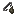

# Gameplay Changes

Rules that differ from vanilla survival, and why.

<a class="card" href="beds.html">

Beds & Spawning

Why you cannot set a spawn point below Orth
</a>

<a class="card" href="time.html">

Time of Day

Every layer shares Orth's clock
</a>

## Summary

| Rule | Behaviour |
| ---- | --------- |
| Beds and respawn anchors | **Cannot set a spawn point** |
| `/spawnpoint` | Works — operators keep the escape hatch |
| Dying | Sends you to **Orth's world spawn** |
| Time of day | Copied from Orth to every other layer once a minute |
| Monster spawning | Disabled in Orth and the First |
