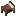
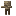

<!-- markdownlint-disable MD013 -->

# Gameplay Changes

Rules that differ from vanilla survival, from beds and respawns to shared clocks and the Curse.

Beds and Respawn Anchors
Cannot set a spawn point.

Dying
Sends you to Orth's world spawn.

Time of Day
Copied from Orth to every other layer once a minute.

Monster Spawning
Disabled in Orth and the First.

