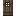
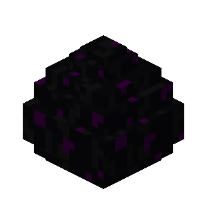
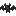
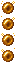

<!-- markdownlint-disable MD013 -->

# Mine in Abyss

Welcome to the official wiki for **Mine in Abyss**, the Made in Abyss recreation on the Illyria Minecraft server.

## Categories

<a class="card" href="getting-started/joining.html">

Getting Started

How to connect, server rules, and the resource pack
</a>

<a class="card" href="layers/index.html">

The Abyss

Eight layers, the Curse, and how to travel between them
</a>

<a class="card" href="creatures/index.html">

Creatures

Every creature of the Abyss, layer by layer
</a>

<a class="card" href="gameplay/index.html">

Gameplay Changes

Beds, respawns, shared clocks, and more
</a>

## About the Server

Mine in Abyss recreates the world of _Made in Abyss_ as a vertical adventure. Each layer is a
hand-built map with its own creatures, its own dangers, and its own place in the Curse:

-  **Eight layers** — from the City on the
  Edge down to the Final Maelstrom
-  **The Curse of the Abyss** —
  ascending is what hurts, and it compounds
-  **65 creatures** that never leave
  the layer they were born in
