<!-- markdownlint-disable MD013 -->

# Items

Things that are not vanilla, even where the base item is: the items of the Abyss and what they do.

Orthcoin
The currency of Orth, the City on the Edge.

Abyssal Snail Shell
The spiral shell of an Abyssal Snail.

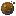

Abyssal Snail Gunk
Viscous gunk left by an Abyssal Snail.

Ashimite Meat Raw
Dropped by the Ashimite.

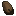

Ashimite Hoof
Dropped by the Ashimite.

Ashimite Antlers
Dropped by the Ashimite.

Billabonk Leg Raw
Dropped by the Billabonk.

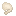

Fuwagi Meat Raw
Dropped by the Fuwagi.

Fuwagi Foot
Dropped by the Fuwagi.

Fuwagi Hide
Dropped by the Fuwagi.

Ikonia Plate
Dropped by the Ikonia.

Kakatsumuri Shell
Dropped by the Kakatsumuri.

Kakatsumuri Glowing Tip
Dropped by the Kakatsumuri.

Neritantan Meat Raw
Dropped by the Neritantan.

Okibo Meat Raw
Dropped by the Okibo.

Okibo Fur
Dropped by the Okibo.

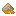

Sakuranbo Dust
Dropped by the Sakuranbo.

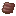

Shroombear Meat Raw
Dropped by the Shroombear.

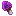

Parasitic Watershrooms
Dropped by the Shroombear.

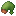

Tesuchi Tail
Dropped by the Tesuchi.

Tesuchi Scales
Dropped by the Tesuchi.

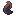

Beniguma Fur
Dropped by the Beniguma.

Chimokami Tail
Dropped by the Chimokami.

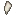

Chimokami Fang
Dropped by the Chimokami.

Daikonchu Carapace
Dropped by the Daikonchu.

Daikonchu Wing
Dropped by the Daikonchu.

Hisoishi Claw
Dropped by the Hisoishi.

Hisoishi Shell
Dropped by the Hisoishi.

Rinsipede Segments
Dropped by the Rinsipede.

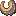

Rockwalker Mandible
Dropped by the Rockwalker.

Spikewalker Spike
Dropped by the Spikewalker.

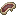

Spikewalker Meat
Dropped by the Spikewalker.

Titanjaw Pearl
Dropped by the Titanjaw.

Titanjaw Scale
Dropped by the Titanjaw.

Buroguro Lantern
Dropped by the Buroguro.

Buroguro Stinger
Dropped by the Buroguro.

Corpse Weeper Meat Raw
Dropped by the Corpse Weeper.

Corpse Weeper Eye
Dropped by the Corpse Weeper.

Corpse Weeper Feather
Dropped by the Corpse Weeper.

Cyatoria Drumstick Raw
Dropped by the Cyatoria.

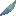

Cyatoria Feather
Dropped by the Cyatoria.

Dosetori Meat Raw
Dropped by the Dosetori.

Dosetori Wing
Dropped by the Dosetori.

Dosetori Bone
Dropped by the Dosetori.

Hammerbeak Wing Raw
Dropped by the Giant Hammerbeak.

Hammerbeak Beak
Dropped by the Giant Hammerbeak.

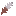

Hammerbeak Feather
Dropped by the Giant Hammerbeak.

Hammerbeak Egg
Dropped by the Giant Hammerbeak.

Hashofu Tail Raw
Dropped by the Hashofu.

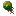

Hashofu Eye
Dropped by the Hashofu.

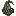

Hashofu Body
Dropped by the Hashofu.

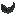

Kagi Tachikiri Pincer
Dropped by the Kagi Tachikiri.

Madokajack Scales
Dropped by the Madokajack.

Madokajack Bone
Dropped by the Madokajack.

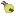

Madokajack Eye
Dropped by the Madokajack.

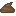

Madokajack Poop
Dropped by the Madokajack.

Onitsuchi Wing Raw
Dropped by the Onitsuchi.

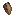

Onitsuchi Skull
Dropped by the Onitsuchi.

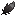

Onitsuchi Feather
Dropped by the Onitsuchi.

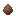

Onitsuchi Egg
Dropped by the Onitsuchi.

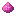

Rohana Powder
Dropped by the Rohana.

Rohana Tail
Dropped by the Rohana.

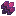

Splitjaw Scales
Dropped by the Splitjaw.

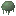

Splitjaw Gunk
Dropped by the Splitjaw.

Spore Manta Wing
Dropped by the Spore Manta.

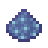

Spore Manta Powder
Dropped by the Spore Manta.

Squidfly Brain Raw
Dropped by the Squidfly.

Stinger Wing
Dropped by the Stinger.

Stinger Horn
Dropped by the Stinger.

Demonfish Raw
Dropped by the Demonfish.

Edusan Scale
Dropped by the Edusan.

Edusan Whisker
Dropped by the Edusan.

Hagamizukin Tooth
Dropped by the Hagamizukin.

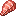

Hagamizukin Raw
Dropped by the Hagamizukin.

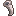

Hisomukuro Rib
Dropped by the Hisomukuro.

Ikenosuke Raw
Dropped by the Ikenosuke.

Kazura Squid Ink Sac
Dropped by the Kazura.

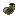

Makihige Ink Sac
Dropped by the Makihige.

Makihige Shell
Dropped by the Makihige.

Makihige Tentacle
Dropped by the Makihige.

Spiralsquid Raw
Dropped by the Spiralsquid.

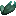

Chikyuoebi Raw
Dropped by the Chikyuoebi.

Himushi Core
Dropped by the Himushi.

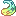

Horncrier Horn
Dropped by the Horncrier.

Inbyo Meat Raw
Dropped by the Inbyo.

Inbyo Fur
Dropped by the Inbyo.

Kuongatari Juice
Dropped by the Kuongatari.

Kuongatari Silk
Dropped by the Kuongatari.

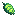

Kuongatari Abdomen
Dropped by the Kuongatari.

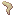

Mantoyer Fur
Dropped by the Man toyer.

Mantoyer Horns
Dropped by the Man toyer.

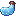

Octoliar Ink Sac
Dropped by the Octoliar.

Octoliar Tentacle
Dropped by the Octoliar.

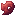

Orb Piercer Face Fragments
Dropped by the Orb Piercer.

Orb Piercer Spike
Dropped by the Orb Piercer.

Ottobas Meat Raw
Dropped by the Ottobas.

Shiratsubi Wing
Dropped by the Shiratsubi.

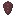

Yomotsubi Abdomen Raw
Dropped by the Shiratsubi.

Silkfang Eye
Dropped by the Silkfang.

Silkfang Silk
Dropped by the Silkfang.

Bundle Of Silkfang Silk
Dropped by the Silkfang.

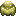

Plant Matter
Dropped by the Spittleshrub.

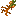

Spittleshrub Root
Dropped by the Spittleshrub.

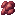

Stingerhead Scale
Dropped by the Stingerhead.

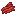

Stingerhead Flesh
Dropped by the Stingerhead.

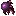

Stingerhead Eye
Dropped by the Stingerhead.

Swarmshocker Charged Powder
Dropped by the Swarmhoarder.

Swarmshocker Jelly
Dropped by the Swarmhoarder.

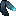

Tachikatana Leg
Dropped by the Tachikatana.

Tachikatana Claw
Dropped by the Tachikatana.

Tachikatana Scale
Dropped by the Tachikatana.

Uibuta Meat Raw
Dropped by the Uibuta.

Uibuta Tooth
Dropped by the Uibuta.

Virinsipede Segments
Dropped by the Virinsipede.

Virinsipede Antlers
Dropped by the Virinsipede.

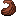

Woodcrier Horn
Dropped by the Woodcrier.

Yomotsubi Wing
Dropped by the Yomotsubi.

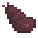

Yomotsubi Abdomen
Dropped by the Yomotsubi.

