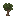

<!-- markdownlint-disable MD013 -->

# Curse of the Abyss

The Curse is the central mechanic of the Abyss: **descending is free, ascending is not**.

Every layer you climb out of adds to a hidden value called your **strain**. Strain is stored on
your character and survives logout, so it follows you until something cures it.

<a class="card" href="travel.html">

How strain is added

Each layer has a curse value equal to its depth
</a>

<a class="card" href="travel.html">

How strain is cured

Reaching Orth, or dying, clears it completely
</a>

## The Severity Ladder

The severity of the symptoms depends on your **total** strain, not on the layer you just left.
That is why climbing two layers in a row is so much worse than climbing one and resting.

| Strain | Symptoms |
| :-: | :------- |
| 1 | Nausea |
| 2 | Nausea, Weakness |
| 3 | Nausea, brief Blindness, Slowness |
| 4 | Nausea, Blindness, Weakness, 2 damage |
| 5 | Blindness, Weakness, 8 damage, health reduced to 1 |
| 6 | **Death** |

Strain caps at 6, and 6 is fatal. Since you cannot exceed the cap, reaching it is the worst the
Curse can do — but reaching it is not survivable.

## Adding It Up

Ascending out of a layer adds that layer's depth: leaving the First adds 1, leaving the Fourth
adds 4, leaving the Sixth adds 6. Values are saturating — a 5 plus a 4 leaves you at 6, not 9.

| You climb out of | Strain added |
| :--------------- | :----------: |
| First | 1 |
| Second | 2 |
| Third | 3 |
| Fourth | 4 |
| Fifth | 5 |
| Sixth | 6 (fatal on its own) |

Ascending from Orth adds nothing — there is nowhere above it to climb from.

## Recovering

- **Reach Orth** and your strain drops to 0.
- **Die** — of the Curse or anything else — and your strain drops to 0 as you respawn.
- There is no other cure. There is no potion, no bed, and no waiting it out.

## Practical Advice

- **Climb one layer at a time and descend again** to reset the danger, rather than trying to
  climb straight to the surface from the Fifth.
- **A single ascent from the Sixth kills you outright.** If you are in the Capital of the
  Unreturned, there is no climbing out alive.
- **Beds do not help you.** You cannot set a spawn point outside Orth — see
  [Beds & Spawning](../gameplay/beds.md).
