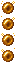
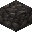
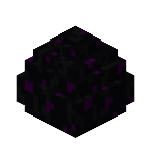

<!-- markdownlint-disable MD013 -->

# The Layers

There are eight layers, from the surface down. Each is a hand-built map with its own creatures,
and each one takes its turn worsening the Curse.

| # | Layer                             | World    | Creatures |
| :-: | :------------------------------ | :------- | :-------: |
| 0 |  **Orth** — The City on the Edge | — | 1 |
| 1 |  **First** — Depths of the Abyss | — | 20 |
| 2 |  **Second** — The Forest of Temptation | — | 21 |
| 3 |  **Third** — The Great Fault | — | 14 |
| 4 |  **Fourth** — The Goblets of Giants | — | 18 |
| 5 |  **Fifth** — The Sea of Corpses | — | 26 |
| 6 |  **Sixth** — The Capital of the Unreturned | — | 0 |
| 7 |  **Seventh** — The Final Maelstrom | — | 0 |

## Orth

**The City on the Edge** is the surface layer, the place every descent begins and every ascent
ends. It disables monster spawning, so it is a safe place to prepare.

The Curse does not apply here. Arriving in Orth — or respawning after death — **cures your
strain entirely**.

## First — Depths of the Abyss

The first layer proper. Twenty creatures live here across every category, from the harmless
Fuwagi to the 45-heart Ottobas.

Like Orth, monster spawning is disabled, so nothing hunts you by darkness alone.

## Second — The Forest of Temptation

The woodland layer, and the first with a full complement of hostile creatures. Twenty-one kinds
live here.

## Third — The Great Fault

A broken landscape of stone and chasms. Fourteen kinds live here, including the Docile
Daikonchu — forty hearts, and harmless unless provoked.

## Fourth — The Goblets of Giants

Home to eighteen creatures, including some of the largest aerial kinds in the Abyss. The Orb
Piercer — ninety hearts — lives here.

## Fifth — The Sea of Corpses

The deepest layer with a full ecosystem: twenty-six kinds, from the 2.5-heart Kazura to the
Stingerhead at 130 hearts.

## Sixth & Seventh

These layers have **no creatures at all**. Natural spawning is suppressed and nothing replaces
it, so they are empty. This is deliberate — no creature has been authored for them yet — but it
does mean a descent past the Fifth leaves you in silence.

The Seventh, the Final Maelstrom, is the end of the Abyss. There is no layer beneath it: falling
out of the bottom is handled by vanilla void damage rather than a descent.
