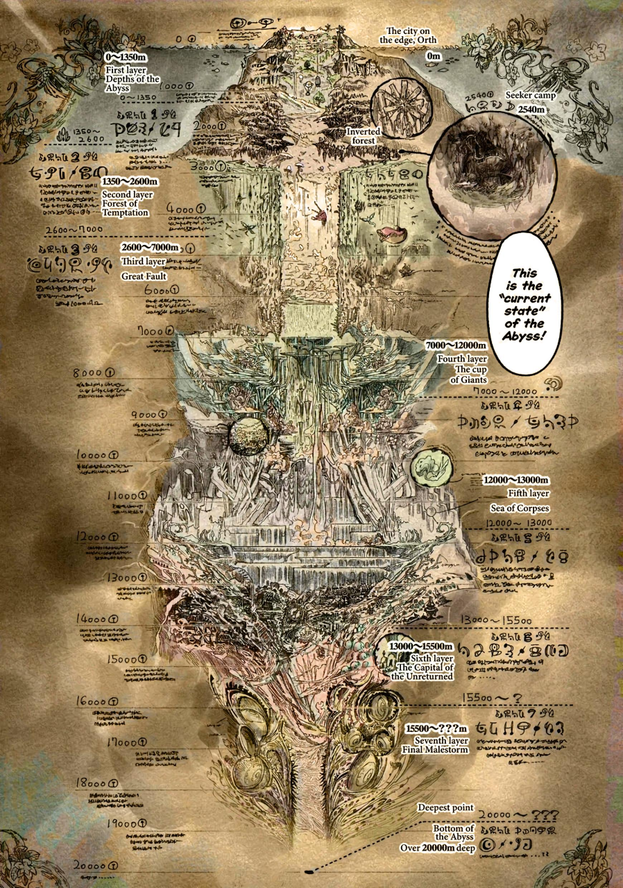

<!-- markdownlint-disable MD013 -->

# The Layers

There are eight layers, from the surface down. Each is a hand-built map with its own creatures,
and each one takes its turn worsening the Curse.

Hover over a layer to see its name.

<button class="hotspot" style="--top: 0%; --height: 5.39%" data-name="Orth" data-depth="0m"><strong>Orth</strong> — The City on the Edge</button>
<button class="hotspot" style="--top: 5.39%; --height: 10.94%" data-name="First" data-depth="0~1350m"><strong>First layer</strong> — Depths of the Abyss</button>
<button class="hotspot" style="--top: 16.33%; --height: 10.31%" data-name="Second" data-depth="1350~2600m"><strong>Second layer</strong> — The Forest of Temptation</button>
<button class="hotspot" style="--top: 26.64%; --height: 6.72%" data-name="Third" data-depth="2600~7000m"><strong>Third layer</strong> — The Great Fault</button>
<button class="hotspot" style="--top: 33.36%; --height: 11.33%" data-name="Fourth" data-depth="7000~12000m"><strong>Fourth layer</strong> — The Goblets of Giants</button>
<button class="hotspot" style="--top: 44.69%; --height: 26.02%" data-name="Fifth" data-depth="12000~13000m"><strong>Fifth layer</strong> — The Sea of Corpses</button>
<button class="hotspot" style="--top: 70.70%; --height: 8.67%" data-name="Sixth" data-depth="13000~15500m"><strong>Sixth layer</strong> — The Capital of the Unreturned</button>
<button class="hotspot" style="--top: 79.38%; --height: 20.62%" data-name="Seventh" data-depth="15500m+"><strong>Seventh layer</strong> — The Final Maelstrom</button>

