<!-- markdownlint-disable MD013 -->

# Traders

Every trader of Orth, sorted by name or district - who they are, where they stand and what they sell.

<label class="sort-label" for="trader-sort-select">Sort by</label>
<select id="trader-sort-select" class="sort-select">
<option value="name-asc" selected>A–Z</option>
<option value="name-desc">Z–A</option>
<option value="category-asc">District ascending</option>
<option value="category-desc">District descending</option>
</select>

Odroy, The Apothecary
Coordinates: (?,?,?)Central Orth District
Sells cures and reagents.

9 trades

<table class="trader-trades">
<thead><tr><th>Give</th><th>Receive</th></tr></thead>
<tbody><tr><td></td><td>4</td></tr>
<tr><td></td><td>5</td></tr>
<tr><td></td><td>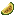10</td></tr>
<tr><td></td><td>2</td></tr>
<tr><td></td><td>2</td></tr>
<tr><td></td><td>2</td></tr>
<tr><td></td><td>3</td></tr>
<tr><td></td><td>2</td></tr>
<tr><td>80</td><td></td></tr>
</tbody>
</table>

John, Wheat Dealer
Coordinates: (?,?,?)Central Orth District
The wheat dealer of the Central District.

7 trades

<table class="trader-trades">
<thead><tr><th>Give</th><th>Receive</th></tr></thead>
<tbody><tr><td></td><td>32</td></tr>
<tr><td>14</td><td>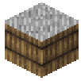64</td></tr>
<tr><td></td><td>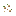32</td></tr>
<tr><td></td><td>6</td></tr>
<tr><td></td><td>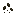8</td></tr>
<tr><td></td><td>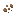64</td></tr>
<tr><td>3</td><td>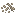64</td></tr>
</tbody>
</table>

Gael, Glass Master
Coordinates: (?,?,?)Central Orth District
The glass master of the Central District.

17 trades

<table class="trader-trades">
<thead><tr><th>Give</th><th>Receive</th></tr></thead>
<tbody><tr><td></td><td>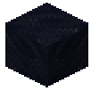64</td></tr>
<tr><td></td><td>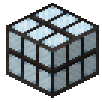64</td></tr>
<tr><td></td><td>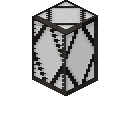64</td></tr>
<tr><td></td><td>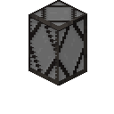64</td></tr>
<tr><td></td><td>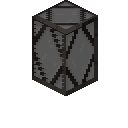64</td></tr>
<tr><td></td><td>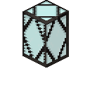64</td></tr>
<tr><td></td><td>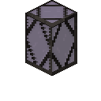64</td></tr>
<tr><td></td><td>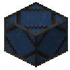64</td></tr>
<tr><td></td><td>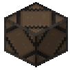64</td></tr>
<tr><td></td><td>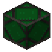64</td></tr>
<tr><td></td><td>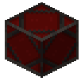64</td></tr>
<tr><td></td><td>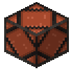64</td></tr>
<tr><td></td><td>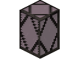64</td></tr>
<tr><td></td><td>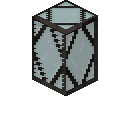64</td></tr>
<tr><td></td><td>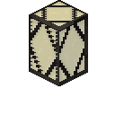64</td></tr>
<tr><td></td><td>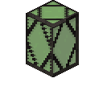64</td></tr>
<tr><td></td><td>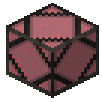64</td></tr>
</tbody>
</table>

Frank, Ocean Fanatic
Coordinates: (?,?,?)Central Orth District
Trades coral and prismarine.

18 trades

<table class="trader-trades">
<thead><tr><th>Give</th><th>Receive</th></tr></thead>
<tbody><tr><td>2</td><td>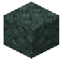64</td></tr>
<tr><td>4</td><td>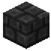64</td></tr>
<tr><td>6</td><td>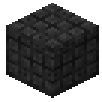64</td></tr>
<tr><td>4</td><td>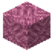16</td></tr>
<tr><td>4</td><td>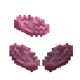16</td></tr>
<tr><td>4</td><td>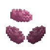16</td></tr>
<tr><td>4</td><td>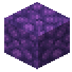16</td></tr>
<tr><td>4</td><td>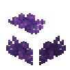16</td></tr>
<tr><td>4</td><td>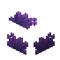16</td></tr>
<tr><td>4</td><td>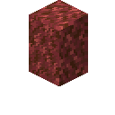16</td></tr>
<tr><td>4</td><td>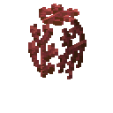16</td></tr>
<tr><td>4</td><td>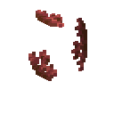16</td></tr>
<tr><td>4</td><td>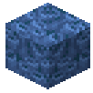16</td></tr>
<tr><td>4</td><td>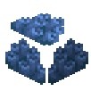16</td></tr>
<tr><td>4</td><td>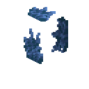16</td></tr>
<tr><td>4</td><td>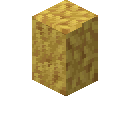16</td></tr>
<tr><td>4</td><td>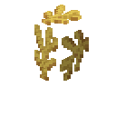16</td></tr>
<tr><td>4</td><td>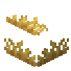16</td></tr>
</tbody>
</table>

Cedric, Cementer
Coordinates: (?,?,?)Central Orth District
Trades concrete powder.

16 trades

<table class="trader-trades">
<thead><tr><th>Give</th><th>Receive</th></tr></thead>
<tbody><tr><td></td><td>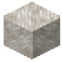64</td></tr>
<tr><td></td><td>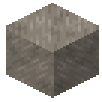64</td></tr>
<tr><td></td><td>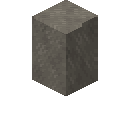64</td></tr>
<tr><td></td><td>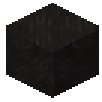64</td></tr>
<tr><td></td><td>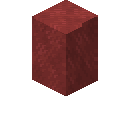64</td></tr>
<tr><td></td><td>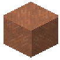64</td></tr>
<tr><td></td><td>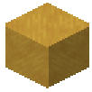64</td></tr>
<tr><td></td><td>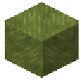64</td></tr>
<tr><td></td><td>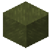64</td></tr>
<tr><td></td><td>64</td></tr>
<tr><td></td><td>64</td></tr>
<tr><td></td><td>64</td></tr>
<tr><td></td><td>64</td></tr>
<tr><td></td><td>64</td></tr>
<tr><td></td><td>64</td></tr>
<tr><td></td><td>64</td></tr>
</tbody>
</table>

Murdock, Mudboy
Coordinates: (?,?,?)Central Orth District
The mudboy of the Central District.

4 trades

<table class="trader-trades">
<thead><tr><th>Give</th><th>Receive</th></tr></thead>
<tbody><tr><td></td><td>64</td></tr>
<tr><td></td><td>64</td></tr>
<tr><td></td><td>64</td></tr>
<tr><td></td><td>64</td></tr>
</tbody>
</table>

Larry, Sculk Lord
Coordinates: (?,?,?)Central Orth District
The sculk lord of the Central District.

8 trades

<table class="trader-trades">
<thead><tr><th>Give</th><th>Receive</th></tr></thead>
<tbody><tr><td>4</td><td>64</td></tr>
<tr><td>4</td><td>64</td></tr>
<tr><td>4</td><td>64</td></tr>
<tr><td>8</td><td>32</td></tr>
<tr><td>8</td><td>4</td></tr>
<tr><td>4</td><td>64</td></tr>
<tr><td>4</td><td>64</td></tr>
<tr><td>4</td><td>64</td></tr>
</tbody>
</table>

Rutrix, DJ
Coordinates: (?,?,?)Central Orth District
The disc trader of the Central District.

16 trades

<table class="trader-trades">
<thead><tr><th>Give</th><th>Receive</th></tr></thead>
<tbody><tr><td>10</td><td></td></tr>
<tr><td>10</td><td></td></tr>
<tr><td>10</td><td></td></tr>
<tr><td>10</td><td></td></tr>
<tr><td>10</td><td></td></tr>
<tr><td>10</td><td></td></tr>
<tr><td>10</td><td></td></tr>
<tr><td>10</td><td></td></tr>
<tr><td>10</td><td></td></tr>
<tr><td>10</td><td></td></tr>
<tr><td>10</td><td></td></tr>
<tr><td>10</td><td></td></tr>
<tr><td>10</td><td></td></tr>
<tr><td>10</td><td></td></tr>
<tr><td>10</td><td></td></tr>
<tr><td>10</td><td></td></tr>
</tbody>
</table>

Norah, The Warped
Coordinates: (?,?,?)Central Orth District
The warped-wood trader of the Central District.

9 trades

<table class="trader-trades">
<thead><tr><th>Give</th><th>Receive</th></tr></thead>
<tbody><tr><td>3</td><td>64</td></tr>
<tr><td>3</td><td>64</td></tr>
<tr><td></td><td>64</td></tr>
<tr><td></td><td>64</td></tr>
<tr><td>4</td><td>64</td></tr>
<tr><td>4</td><td>32</td></tr>
<tr><td>4</td><td>48</td></tr>
<tr><td></td><td>16</td></tr>
<tr><td></td><td>16</td></tr>
</tbody>
</table>

Headmaster, The Head Trader
Coordinates: (?,?,?)Central Orth District
Sells heads.

4 trades

<table class="trader-trades">
<thead><tr><th>Give</th><th>Receive</th></tr></thead>
<tbody><tr><td>12</td><td></td></tr>
<tr><td>12</td><td></td></tr>
<tr><td>12</td><td></td></tr>
<tr><td>12</td><td></td></tr>
</tbody>
</table>

Nereth, Underworld Merchant
Coordinates: (?,?,?)Central Orth District
Trades nether goods.

7 trades

<table class="trader-trades">
<thead><tr><th>Give</th><th>Receive</th></tr></thead>
<tbody><tr><td></td><td>32</td></tr>
<tr><td></td><td>6</td></tr>
<tr><td></td><td>6</td></tr>
<tr><td></td><td>10</td></tr>
<tr><td></td><td>16</td></tr>
<tr><td></td><td>7</td></tr>
<tr><td>4</td><td>29</td></tr>
</tbody>
</table>

Bob, Handyman
Coordinates: (?,?,?)Residential District
The handyman of the Residential District.

6 trades

<table class="trader-trades">
<thead><tr><th>Give</th><th>Receive</th></tr></thead>
<tbody><tr><td></td><td></td></tr>
<tr><td></td><td>4</td></tr>
<tr><td></td><td>4</td></tr>
<tr><td></td><td></td></tr>
<tr><td></td><td></td></tr>
<tr><td></td><td>8</td></tr>
</tbody>
</table>

Veris, Gem Lover
Coordinates: (?,?,?)Residential District
The gem lover of the Residential District.

4 trades

<table class="trader-trades">
<thead><tr><th>Give</th><th>Receive</th></tr></thead>
<tbody><tr><td></td><td>32</td></tr>
<tr><td></td><td>16</td></tr>
<tr><td></td><td>8</td></tr>
<tr><td></td><td>32</td></tr>
</tbody>
</table>

Evril, Void Seeker
Coordinates: (?,?,?)Residential District
The void seeker of the Residential District.

3 trades

<table class="trader-trades">
<thead><tr><th>Give</th><th>Receive</th></tr></thead>
<tbody><tr><td></td><td>8</td></tr>
<tr><td></td><td>12</td></tr>
<tr><td>3</td><td>16</td></tr>
</tbody>
</table>

Alistair, Geomancy Enjoyer
Coordinates: (?,?,?)Residential District
The geomancy enjoyer of the Residential District.

2 trades

<table class="trader-trades">
<thead><tr><th>Give</th><th>Receive</th></tr></thead>
<tbody><tr><td>3</td><td>64</td></tr>
<tr><td>5</td><td>64</td></tr>
</tbody>
</table>

Dayne, Storage
Coordinates: (?,?,?)Residential District
The storage trader of the Residential District.

3 trades

<table class="trader-trades">
<thead><tr><th>Give</th><th>Receive</th></tr></thead>
<tbody><tr><td>10</td><td></td></tr>
<tr><td>10</td><td></td></tr>
<tr><td>10</td><td></td></tr>
</tbody>
</table>

Cress, Plant Lover
Coordinates: (?,?,?)Residential District
The plant lover of the Residential District.

15 trades

<table class="trader-trades">
<thead><tr><th>Give</th><th>Receive</th></tr></thead>
<tbody><tr><td></td><td>32</td></tr>
<tr><td></td><td>64</td></tr>
<tr><td></td><td>64</td></tr>
<tr><td></td><td>64</td></tr>
<tr><td></td><td>32</td></tr>
<tr><td></td><td>32</td></tr>
<tr><td></td><td>16</td></tr>
<tr><td></td><td>32</td></tr>
<tr><td></td><td>32</td></tr>
<tr><td></td><td>32</td></tr>
<tr><td></td><td>16</td></tr>
<tr><td></td><td>16</td></tr>
<tr><td></td><td>16</td></tr>
<tr><td></td><td>16</td></tr>
<tr><td></td><td>32</td></tr>
</tbody>
</table>

Heath, Stone Man
Coordinates: (?,?,?)Residential District
The stone man of the Residential District.

3 trades

<table class="trader-trades">
<thead><tr><th>Give</th><th>Receive</th></tr></thead>
<tbody><tr><td></td><td>64</td></tr>
<tr><td></td><td>64</td></tr>
<tr><td></td><td>64</td></tr>
</tbody>
</table>

Pete, Pothead
Coordinates: (?,?,?)Residential District
The pothead of the Residential District.

2 trades

<table class="trader-trades">
<thead><tr><th>Give</th><th>Receive</th></tr></thead>
<tbody><tr><td>10</td><td></td></tr>
<tr><td>10</td><td></td></tr>
</tbody>
</table>

BucketBill, Bucket Trader
Coordinates: (?,?,?)Residential District
The bucket trader of the Residential District.

6 trades

<table class="trader-trades">
<thead><tr><th>Give</th><th>Receive</th></tr></thead>
<tbody><tr><td></td><td></td></tr>
<tr><td>12</td><td></td></tr>
<tr><td>6</td><td></td></tr>
<tr><td>6</td><td></td></tr>
<tr><td>3</td><td></td></tr>
<tr><td>3</td><td></td></tr>
</tbody>
</table>

John, Meat Slinger
Coordinates: (?,?,?)Residential District
The meat slinger of the Residential District.

9 trades

<table class="trader-trades">
<thead><tr><th>Give</th><th>Receive</th></tr></thead>
<tbody><tr><td></td><td>10</td></tr>
<tr><td></td><td>12</td></tr>
<tr><td></td><td>32</td></tr>
<tr><td>3</td><td></td></tr>
<tr><td>16</td><td></td></tr>
<tr><td></td><td>8</td></tr>
<tr><td></td><td></td></tr>
<tr><td></td><td>11</td></tr>
<tr><td></td><td>17</td></tr>
</tbody>
</table>

Berney, Enchanter
Coordinates: (?,?,?)Tower District
A book trader of the Tower District.

3 trades

<table class="trader-trades">
<thead><tr><th>Give</th><th>Receive</th></tr></thead>
<tbody><tr><td>12</td><td></td></tr>
<tr><td>16</td><td></td></tr>
<tr><td>12</td><td></td></tr>
</tbody>
</table>

Bilton, Protector
Coordinates: (?,?,?)Tower District
A book trader of the Tower District.

4 trades

<table class="trader-trades">
<thead><tr><th>Give</th><th>Receive</th></tr></thead>
<tbody><tr><td>12</td><td></td></tr>
<tr><td>10</td><td></td></tr>
<tr><td>10</td><td></td></tr>
<tr><td>10</td><td></td></tr>
</tbody>
</table>

Mark, Weaponsmith
Coordinates: (?,?,?)Tower District
A book trader of the Tower District.

4 trades

<table class="trader-trades">
<thead><tr><th>Give</th><th>Receive</th></tr></thead>
<tbody><tr><td>12</td><td></td></tr>
<tr><td>8</td><td></td></tr>
<tr><td>10</td><td></td></tr>
<tr><td>10</td><td></td></tr>
</tbody>
</table>

Siggy, Strider
Coordinates: (?,?,?)Tower District
A book trader of the Tower District.

3 trades

<table class="trader-trades">
<thead><tr><th>Give</th><th>Receive</th></tr></thead>
<tbody><tr><td>8</td><td></td></tr>
<tr><td>8</td><td></td></tr>
<tr><td>10</td><td></td></tr>
</tbody>
</table>

Robert, Enchanter
Coordinates: (?,?,?)Tower District
A book trader of the Tower District.

4 trades

<table class="trader-trades">
<thead><tr><th>Give</th><th>Receive</th></tr></thead>
<tbody><tr><td>16</td><td></td></tr>
<tr><td>14</td><td></td></tr>
<tr><td>13</td><td></td></tr>
<tr><td>14</td><td></td></tr>
</tbody>
</table>

Tags, Weaponsmith
Coordinates: (?,?,?)Tower District
A book trader of the Tower District.

3 trades

<table class="trader-trades">
<thead><tr><th>Give</th><th>Receive</th></tr></thead>
<tbody><tr><td>9</td><td></td></tr>
<tr><td>8</td><td></td></tr>
<tr><td>9</td><td></td></tr>
</tbody>
</table>

Jacob, Archer
Coordinates: (?,?,?)Tower District
A book trader of the Tower District.

3 trades

<table class="trader-trades">
<thead><tr><th>Give</th><th>Receive</th></tr></thead>
<tbody><tr><td>10</td><td></td></tr>
<tr><td>13</td><td></td></tr>
<tr><td>9</td><td></td></tr>
</tbody>
</table>

Jeff, Enchanter
Coordinates: (?,?,?)Tower District
A book trader of the Tower District.

2 trades

<table class="trader-trades">
<thead><tr><th>Give</th><th>Receive</th></tr></thead>
<tbody><tr><td>12</td><td></td></tr>
<tr><td>10</td><td></td></tr>
</tbody>
</table>

Jag, Protector
Coordinates: (?,?,?)Tower District
A book trader of the Tower District.

2 trades

<table class="trader-trades">
<thead><tr><th>Give</th><th>Receive</th></tr></thead>
<tbody><tr><td>16</td><td></td></tr>
<tr><td>12</td><td></td></tr>
</tbody>
</table>

Hamilton, Weaponsmith
Coordinates: (?,?,?)Tower District
A book trader of the Tower District.

2 trades

<table class="trader-trades">
<thead><tr><th>Give</th><th>Receive</th></tr></thead>
<tbody><tr><td>13</td><td></td></tr>
<tr><td>11</td><td></td></tr>
</tbody>
</table>

Boy, Lord of Currency
Coordinates: (?,?,?)Golden Bridge District
Gives one Orthcoin for a bundle of a single trophy.

41 trades

<table class="trader-trades">
<thead><tr><th>Give</th><th>Receive</th></tr></thead>
<tbody><tr><td>7</td><td></td></tr>
<tr><td>4</td><td></td></tr>
<tr><td>8</td><td></td></tr>
<tr><td>9</td><td></td></tr>
<tr><td>6</td><td></td></tr>
<tr><td>8</td><td></td></tr>
<tr><td>9</td><td></td></tr>
<tr><td>10</td><td></td></tr>
<tr><td>10</td><td></td></tr>
<tr><td>14</td><td></td></tr>
<tr><td>12</td><td></td></tr>
<tr><td>10</td><td></td></tr>
<tr><td>8</td><td></td></tr>
<tr><td>10</td><td></td></tr>
<tr><td>8</td><td></td></tr>
<tr><td>10</td><td></td></tr>
<tr><td>9</td><td></td></tr>
<tr><td>10</td><td></td></tr>
<tr><td>8</td><td></td></tr>
<tr><td>8</td><td></td></tr>
<tr><td>8</td><td></td></tr>
<tr><td>12</td><td></td></tr>
<tr><td>11</td><td></td></tr>
<tr><td>10</td><td></td></tr>
<tr><td>10</td><td></td></tr>
<tr><td>6</td><td></td></tr>
<tr><td>6</td><td></td></tr>
<tr><td>8</td><td></td></tr>
<tr><td>9</td><td></td></tr>
<tr><td>7</td><td></td></tr>
<tr><td>7</td><td></td></tr>
<tr><td>7</td><td></td></tr>
<tr><td>7</td><td></td></tr>
<tr><td>6</td><td></td></tr>
<tr><td>6</td><td></td></tr>
<tr><td>5</td><td></td></tr>
<tr><td>7</td><td></td></tr>
<tr><td>9</td><td></td></tr>
<tr><td>9</td><td></td></tr>
<tr><td>10</td><td></td></tr>
<tr><td>5</td><td></td></tr>
</tbody>
</table>

Benner, Also Lord of Currency
Coordinates: (?,?,?)Golden Bridge District
Boy's companion, and the other Lord of Currency.

14 trades

<table class="trader-trades">
<thead><tr><th>Give</th><th>Receive</th></tr></thead>
<tbody><tr><td>10</td><td></td></tr>
<tr><td>10</td><td></td></tr>
<tr><td>14</td><td></td></tr>
<tr><td>16</td><td></td></tr>
<tr><td>10</td><td></td></tr>
<tr><td>9</td><td></td></tr>
<tr><td>9</td><td></td></tr>
<tr><td>7</td><td></td></tr>
<tr><td>6</td><td></td></tr>
<tr><td>7</td><td></td></tr>
<tr><td>7</td><td></td></tr>
<tr><td>6</td><td></td></tr>
<tr><td>10</td><td></td></tr>
<tr><td>10</td><td></td></tr>
</tbody>
</table>

Quentin, Keen Weaver
Coordinates: (?,?,?)Giant Tree District
The banner weaver of the Giant Tree District.

6 trades

<table class="trader-trades">
<thead><tr><th>Give</th><th>Receive</th></tr></thead>
<tbody><tr><td>4</td><td></td></tr>
<tr><td>4</td><td></td></tr>
<tr><td>4</td><td></td></tr>
<tr><td>4</td><td></td></tr>
<tr><td>4</td><td></td></tr>
<tr><td>4</td><td></td></tr>
</tbody>
</table>

Issac, the Intricate Glazer
Coordinates: (?,?,?)Giant Tree District
The glazed terracotta trader of the Giant Tree District.

16 trades

<table class="trader-trades">
<thead><tr><th>Give</th><th>Receive</th></tr></thead>
<tbody><tr><td></td><td>32</td></tr>
<tr><td></td><td>32</td></tr>
<tr><td></td><td>32</td></tr>
<tr><td></td><td>32</td></tr>
<tr><td></td><td>32</td></tr>
<tr><td></td><td>32</td></tr>
<tr><td></td><td>32</td></tr>
<tr><td></td><td>32</td></tr>
<tr><td></td><td>32</td></tr>
<tr><td></td><td>32</td></tr>
<tr><td></td><td>32</td></tr>
<tr><td></td><td>32</td></tr>
<tr><td></td><td>32</td></tr>
<tr><td></td><td>32</td></tr>
<tr><td></td><td>32</td></tr>
<tr><td></td><td>32</td></tr>
</tbody>
</table>

BeeBill, Bee Keeper
Coordinates: (?,?,?)Slums District
The bee keeper of the Slums District.

6 trades

<table class="trader-trades">
<thead><tr><th>Give</th><th>Receive</th></tr></thead>
<tbody><tr><td>5</td><td></td></tr>
<tr><td>6</td><td></td></tr>
<tr><td></td><td>16</td></tr>
<tr><td></td><td>64</td></tr>
<tr><td>5</td><td>64</td></tr>
<tr><td>3</td><td>64</td></tr>
</tbody>
</table>

