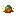
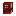

<!-- markdownlint-disable MD013 -->

# Traders

Every trader of Orth, sorted by name or district - who they are, where they stand and what they sell.

<label class="sort-label" for="trader-sort-select">Sort by</label>
<select id="trader-sort-select" class="sort-select">
<option value="name-asc" selected>A–Z</option>
<option value="name-desc">Z–A</option>
<option value="category-asc">District ascending</option>
<option value="category-desc">District descending</option>
</select>

Odroy, The Apothecary
Coordinates: (?,?,?)Central Orth District
Sells cures and reagents.

John, Wheat Dealer
Coordinates: (?,?,?)Central Orth District
The wheat dealer of the Central District.

Gael, Glass Master
Coordinates: (?,?,?)Central Orth District
The glass master of the Central District.

Frank, Ocean Fanatic
Coordinates: (?,?,?)Central Orth District
Trades coral and prismarine.

Cedric, Cementer
Coordinates: (?,?,?)Central Orth District
Trades concrete powder.

Murdock, Mudboy
Coordinates: (?,?,?)Central Orth District
The mudboy of the Central District.

Larry, Sculk Lord
Coordinates: (?,?,?)Central Orth District
The sculk lord of the Central District.

Rutrix, DJ
Coordinates: (?,?,?)Central Orth District
The disc trader of the Central District.

Norah, The Warped
Coordinates: (?,?,?)Central Orth District
The warped-wood trader of the Central District.

Headmaster, The Head Trader
Coordinates: (?,?,?)Central Orth District
Sells heads.

Nereth, Underworld Merchant
Coordinates: (?,?,?)Central Orth District
Trades nether goods.

Bob, Handyman
Coordinates: (?,?,?)Residential District
The handyman of the Residential District.

Veris, Gem Lover
Coordinates: (?,?,?)Residential District
The gem lover of the Residential District.

Evril, Void Seeker
Coordinates: (?,?,?)Residential District
The void seeker of the Residential District.

Alistair, Geomancy Enjoyer
Coordinates: (?,?,?)Residential District
The geomancy enjoyer of the Residential District.

Dayne, Storage
Coordinates: (?,?,?)Residential District
The storage trader of the Residential District.

Cress, Plant Lover
Coordinates: (?,?,?)Residential District
The plant lover of the Residential District.

Heath, Stone Man
Coordinates: (?,?,?)Residential District
The stone man of the Residential District.

Pete, Pothead
Coordinates: (?,?,?)Residential District
The pothead of the Residential District.

BucketBill, Bucket Trader
Coordinates: (?,?,?)Residential District
The bucket trader of the Residential District.

John, Meat Slinger
Coordinates: (?,?,?)Residential District
The meat slinger of the Residential District.

Berney, Enchanter
Coordinates: (?,?,?)Tower District
A book trader of the Tower District.

Bilton, Protector
Coordinates: (?,?,?)Tower District
A book trader of the Tower District.

Mark, Weaponsmith
Coordinates: (?,?,?)Tower District
A book trader of the Tower District.

Siggy, Strider
Coordinates: (?,?,?)Tower District
A book trader of the Tower District.

Robert, Enchanter
Coordinates: (?,?,?)Tower District
A book trader of the Tower District.

Tags, Weaponsmith
Coordinates: (?,?,?)Tower District
A book trader of the Tower District.

Jacob, Archer
Coordinates: (?,?,?)Tower District
A book trader of the Tower District.

Jeff, Enchanter
Coordinates: (?,?,?)Tower District
A book trader of the Tower District.

Jag, Protector
Coordinates: (?,?,?)Tower District
A book trader of the Tower District.

Hamilton, Weaponsmith
Coordinates: (?,?,?)Tower District
A book trader of the Tower District.

Boy, Lord of Currency
Coordinates: (?,?,?)Golden Bridge District
Gives one Orthcoin for a bundle of a single trophy.

Benner, Also Lord of Currency
Coordinates: (?,?,?)Golden Bridge District
Boy's companion, and the other Lord of Currency.

Quentin, Keen Weaver
Coordinates: (?,?,?)Giant Tree District
The banner weaver of the Giant Tree District.

Issac, the Intricate Glazer
Coordinates: (?,?,?)Giant Tree District
The glazed terracotta trader of the Giant Tree District.

BeeBill, Bee Keeper
Coordinates: (?,?,?)Slums District
The bee keeper of the Slums District.

